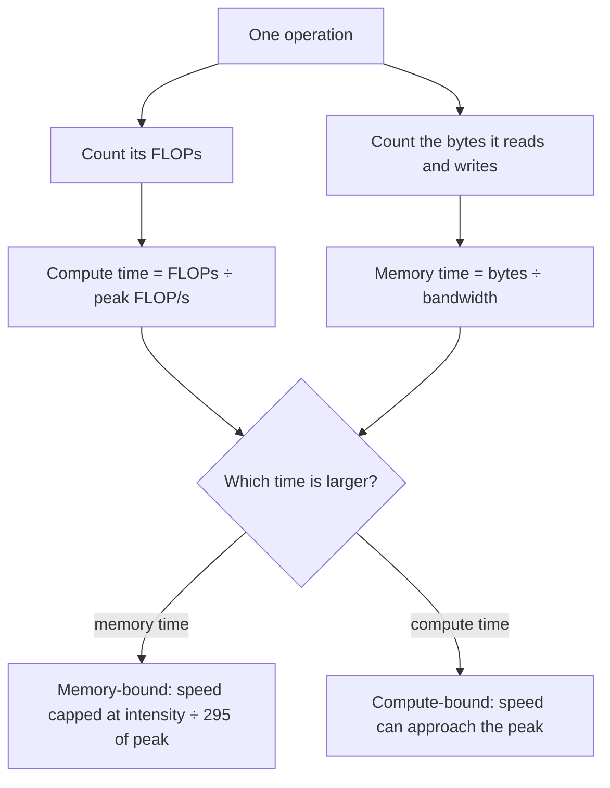

# 02. Resource Accounting: FLOPs, Memory and Arithmetic Intensity

**Level:** Practitioner · **Reading time:** 15 min · **Exercise:** 45 min

> **In one sentence:** After this chapter you can estimate with pen and paper how long a training run takes and how large a model fits on your GPUs, and you can tell whether an operation is limited by arithmetic or by memory traffic.

## Why this matters

A teammate proposes training a 70-billion-parameter model on 15 trillion tokens. Someone asks how long that takes and on how many GPUs. The room goes quiet. CS336's second lecture opens with the same two questions and answers both in under two minutes with a spec sheet and two formulas:

- How long would it take to train a 70B model on 15T tokens with 1,024 H100s?
- What is the largest model you can train on 8 H100s with the AdamW optimizer?

## The core idea

Everything in training is a **tensor**: a block of floating-point numbers with a shape. The data, the **parameters** (the numbers the training adjusts), the **gradients** (how much each parameter should move), the **optimizer state** (running statistics that decide the step size) and the **activations** (intermediate results) are all tensors.

Each tensor sits in memory. Each operation reads some tensors, computes, and writes one. So two resources decide cost:

- **Compute**: how many floating-point operations per second the chip can do.
- **Memory**: how many bytes the chip holds, and how many bytes per second it can move.

The analogy is a very fast assembly worker who must fetch every part from a warehouse with one slow forklift. The analogy breaks in one place: the forklift can deliver the next parts while the worker assembles. Liang assumes the two overlap, so a job takes as long as the slower of the two, not the sum ([44:00](https://www.youtube.com/watch?v=kuYAsz7zspQ&t=2640)).

## How it works, step by step

### 1. Count bytes

Memory for one tensor is its number of values times the bytes per value. A **data type** spends its bits on a sign, an exponent (the range of magnitudes) and a mantissa (the digits of precision).

| Data type | Bytes per value | Note |
|---|---|---|
| fp32 | 4 | The default in PyTorch; the scientific-computing baseline |
| fp16 | 2 | Small numbers lose range, which can destabilize training |
| bf16 | 2 | Same range as fp32, coarser precision (Google Brain, 2018) |
| fp8 | 1 | Standardized in 2022 for machine learning |
| fp4 | 0.5 | 16 possible values, with a separate scale per block |

A 4 × 8 fp32 matrix is 32 values × 4 bytes = 128 bytes. One feedforward matrix in GPT-3 takes about 2.3 GB, Liang notes ([6:00](https://www.youtube.com/watch?v=kuYAsz7zspQ&t=360)).

**Mixed-precision training** uses two types: bf16 for parameters, activations and gradients, and fp32 for optimizer state. PyTorch's automatic mixed precision (AMP) library casts an operation to bf16 when that is safe, as for matrix multiplications, and leaves others such as exponentiation in fp32.

### 2. Name your dimensions

Tensor code is easy to get wrong when shapes are written as `-2` and `-1`. The einops library names dimensions instead, in the spirit of Einstein summation notation. Two rules carry most of it:

- A dimension that appears in both inputs and is missing from the output is summed over.
- A dimension that appears in one input and in the output is kept.

```python
# Illustrative pseudocode (einops API, not executed here)
from einops import einsum, rearrange, reduce

y = einsum(x, w, "b d, d f -> b f")          # d is summed over; result is (b, f)
h = rearrange(y, "b (h f) -> b h f", h=4)    # split f into 4 heads; result is (b, 4, f // 4)
m = reduce(h, "b h f -> b f", "max")         # max over heads; result is (b, f)
```

### 3. Count FLOPs

One **FLOP** is one addition or one multiplication. Two acronyms look alike and mean different things: **FLOPs** is the amount of work, and **FLOP/s** is the speed of the hardware.

For a matrix product of `X` (B × D) with `W` (D × F), each of the B × F outputs needs D multiplications and D additions: 2·B·D·F FLOPs.

For the backward pass, the cost is twice the forward pass, because each layer computes two gradients: one for its inputs and one for its weights. That is Liang's derivation on screen: each gradient is a matrix product over the same dimensions as the forward one ([64:00](https://www.youtube.com/watch?v=kuYAsz7zspQ&t=3840)).

| Pass | FLOPs |
|---|---|
| Forward | 2 · (number of data points) · (number of parameters) |
| Backward | 4 · (number of data points) · (number of parameters) |
| Total | 6 · (number of data points) · (number of parameters) |

This is exact for stacks of linear layers. For Transformers it is a good approximation as long as the context length is not too large; a long context adds a term that grows with its square and sits outside this accounting ([66:00](https://www.youtube.com/watch?v=kuYAsz7zspQ&t=3960)).

### 4. Compare with the hardware: MFU

The **model FLOPs utilization** (MFU) is the FLOP/s your run achieves divided by the peak FLOP/s of the chip. Liang's rule: about 0.5 on a modern model is something to be happy with ([36:00](https://www.youtube.com/watch?v=kuYAsz7zspQ&t=2160)).

### 5. Find the bottleneck: arithmetic intensity

- **Arithmetic intensity** of an operation: FLOPs divided by the bytes it moves.
- **Accelerator intensity** of a chip: peak FLOP/s divided by memory bandwidth. For an H100 in bf16, about 989.5 trillion ÷ 3.35 trillion, which is 295 on Liang's spec sheet, so roughly 300 FLOPs per byte ([46:00](https://www.youtube.com/watch?v=kuYAsz7zspQ&t=2760)).

An operation is **memory-bound** when its arithmetic intensity is below the chip's, and **compute-bound** when it is above. The MFU you can reach is `min(1, arithmetic intensity ÷ accelerator intensity)`.

ReLU and GeLU are activation functions, applied to each value alone: ReLU zeroes negative values and GeLU is a smooth version of it.

| Operation (bf16) | Arithmetic intensity | Verdict |
|---|---|---|
| ReLU on a tensor of n values: read 2n bytes, write 2n bytes, n FLOPs | 0.25 | Memory-bound |
| GeLU on the same tensor: about 20 FLOPs per value | About 5 | Still memory-bound |
| Matrix × one vector: 2·D·F FLOPs, 2·D·F bytes of weights | About 1 | Memory-bound. This is generation |
| Matrix × B rows, D = F = 4096, B = 256: 2·B·D·F FLOPs, 2·D·F + 4·B·D bytes of weights, input and output | 228 | Memory-bound |
| The same product with B = 4,096 | About 1,400 | Compute-bound |

**Figure 1.** Where the time goes: an operation takes as long as the slower of compute and memory traffic.



This cap is the roofline: below an intensity of 295, an operation runs no faster than intensity ÷ 295 of peak.

The last two rows are the reason training is efficient and generation is not. Liang's intuition for two square n × n matrices: you move n² numbers and compute with n³, so the intensity grows with the matrix size, roughly n/3 ([52:00](https://www.youtube.com/watch?v=kuYAsz7zspQ&t=3120)). Two things follow. Shrinking an operation that is already memory-bound saves no time. And a Transformer is, to him, essentially large matrix multiplications with a few other operations in between, built to have high arithmetic intensity. Generation is the exception: it produces one token at a time, so each step is a matrix-vector product ([52:00](https://www.youtube.com/watch?v=kuYAsz7zspQ&t=3120)).

### 6. Count memory for training

With Adam, the optimizer state is two statistics per parameter in fp32: 8 bytes. Add 2 bytes for the bf16 parameter and 2 for its gradient: 12 bytes per parameter. AdaGrad keeps one statistic, 4 bytes. Liang demonstrates with AdaGrad, an optimizer from 2011 that predates Adam: in his framing, AdaGrad looks at the second moment of the gradient (its average square), momentum at the first (its average), and Adam combines the two ([66:00](https://www.youtube.com/watch?v=kuYAsz7zspQ&t=3960)).

Activations are the other cost. Training must keep the activations of every layer for the backward pass; his figure is batch size × model dimension × 2 bytes × number of layers ([72:00](https://www.youtube.com/watch?v=kuYAsz7zspQ&t=4320)). Inference keeps only the current layer's. Two tools trade memory for compute:

- **Gradient accumulation**: split a batch into micro-batches, add up their gradients without zeroing them, and update once per full batch.
- **Activation checkpointing** (also called gradient checkpointing or rematerialization): keep only some layers' activations and recompute the rest in the backward pass.

| What you store | Activation memory | Recomputation |
|---|---|---|
| Every layer | O(L) | None |
| No layer | O(1) | O(L²) |
| Every √L layers | O(√L) | O(L) |

Here L is the number of layers.

## Worked example

```python
def training_days(params, tokens, gpus, peak_flops, mfu):
    """Days to train `params` on `tokens`, assuming the model fits."""
    flops = 6 * params * tokens                    # forward (2) + backward (4)
    return flops / (gpus * peak_flops * mfu) / 86400

def largest_model(bytes_per_param, gpus, bytes_per_gpu):
    """Upper bound on parameters that fit, ignoring activations."""
    return gpus * bytes_per_gpu / bytes_per_param

H100_BF16 = 989.5e12                               # dense peak in FLOP/s
training_days(70e9, 15e12, 1024, H100_BF16, 0.5)   # about 144
largest_model(2 + 2 + 4 + 4, 8, 80e9) / 1e9        # 53.3 billion
```

What to observe:

- The first call returns about 144 days, the lecture's 143. At an MFU of 0.4 the same run takes about 180 days. The efficiency assumption moves the answer by weeks.
- The second call returns 53.3 billion: 640 GB of memory ÷ 12 bytes per parameter. It is an upper bound, because activations and communication buffers are not counted.
- Doubling the tokens doubles the days. Doubling the GPUs halves them, if they are used as well.

## What the practitioners say

Percy Liang opens the lecture with news: a training run the class had followed, at 10²³ FLOPs, finished within 0.05 loss of its forecast ([0:00](https://www.youtube.com/watch?v=kuYAsz7zspQ&t=0)). He then works the two opening questions and gives both answers: 143 days, and about 53 billion parameters. His caveat: "the point is not to precisely calculate every single thing, but just get the rough shape of things" ([2:00](https://www.youtube.com/watch?v=kuYAsz7zspQ&t=120)).

The habit he wants is the mindset from Lecture 1: whenever you write a line of code, think about its performance characteristics ([4:00](https://www.youtube.com/watch?v=kuYAsz7zspQ&t=240)).

He notes that fp32 matrix multiplications run "really, really slow" on current chips, because the hardware is built around bf16 and fp8 ([40:00](https://www.youtube.com/watch?v=kuYAsz7zspQ&t=2400)). He explains the **roofline plot**, which puts arithmetic intensity on one axis and achieved FLOP/s on the other: performance rises with intensity until the chip saturates, then flattens ([56:00](https://www.youtube.com/watch?v=kuYAsz7zspQ&t=3360)).

One consequence he draws surprised the class: GeLU does more arithmetic per byte than ReLU, about 20 FLOPs per value and an intensity near 5, yet is no faster in isolation, because 5 is still far below 295 ([48:00](https://www.youtube.com/watch?v=kuYAsz7zspQ&t=2880)). Both are memory-bound, so the extra arithmetic is free and the saving is nil.

He closes with the rule to remember: "matrix multiplications are compute bound, basically everything else is memory bound" ([76:00](https://www.youtube.com/watch?v=kuYAsz7zspQ&t=4560)). Matrix-vector products, which is what generation does, are the memory-bound case. And gradient accumulation is, he says, a very simple code change ([72:00](https://www.youtube.com/watch?v=kuYAsz7zspQ&t=4320)).

For scale, the GPT-3 paper reports 3.14 × 10²³ training FLOPs, and outside estimates put GPT-4 near 2 × 10²⁵.

## Pitfalls

1. **Forgetting the backward pass.** Counting 2·N·D instead of 6·N·D understates cost three times. Fix: always use the factor 6.
2. **Counting only the parameters.** With mixed-precision Adam, budget 12 bytes per parameter, then add activations. Fix: compute both before requesting GPUs.
3. **Assuming peak speed.** Fix: plan with an MFU of 0.4 to 0.5 and measure.
4. **Mixing up FLOPs and FLOP/s.** One is work, the other is speed. Fix: write the units every time.
5. **Cutting FLOPs on a memory-bound operation.** It saves nothing. Fix: cut bytes moved, or fuse operations so intermediate results never reach memory.
6. **Using 6·N·D at long sequence lengths.** The attention term grows. Fix: add it when sequences are long.

## Try it

Save the two functions above as `napkin.py` and write a three-line report.

**Deliverable:** days and memory for three configurations: a 1B model on 20B tokens, a 7B model on 1.5T tokens, and the lecture's 70B run.

You are done when:

- Your script reproduces the lecture's 143 days and 53 billion within 1%.
- For each configuration you report days at MFU 0.3, 0.5 and 0.7, and the number of 80 GB GPUs needed for parameters, gradients and optimizer state.
- You compute the arithmetic intensity of the bf16 matrix product above at batch sizes 16, 256 and 4,096, counting weights, input and output, and label each memory-bound or compute-bound.

**Stretch:** estimate activation memory for the 7B run at a batch of 256 sequences of 2,048 tokens, with 32 layers of width 4,096, each token position counting as one row of the batch. Say how many 80 GB GPUs it needs with the 84 GB of parameters, gradients and optimizer state.

## Key takeaways

- Everything is a tensor. Memory is values times bytes per value.
- A training step costs about 6 × tokens × parameters FLOPs. Divide by the MFU-adjusted peak speed to get time.
- With mixed-precision Adam, plan for 12 bytes per parameter before activations.
- An operation is memory-bound when its arithmetic intensity is below the chip's. Matrix multiplications with many rows are compute-bound; almost everything else is memory-bound.
- Gradient accumulation and activation checkpointing trade memory for time.

## Self-check

1. A model with N parameters takes one training step on B tokens. How many FLOPs is that?
   - A. 2·N·B
   - B. 4·N·B
   - C. 6·N·B
   - D. 8·N·B
2. What is the arithmetic intensity of an operation?
   - A. Its FLOPs divided by the seconds it takes
   - B. Its FLOPs divided by the bytes it moves
   - C. Its bytes divided by the chip's bandwidth
   - D. Its parameters divided by its activations
3. With mixed-precision Adam, about how many bytes does one parameter need?
   - A. 2
   - B. 6
   - C. 12
   - D. 16
4. An operation has arithmetic intensity 4 on a chip whose accelerator intensity is 300. What follows?
   - A. It is compute-bound and reaches full speed
   - B. It is memory-bound and cannot exceed about 1.3% of peak
   - C. It is compute-bound but wastes half the chips
   - D. It is memory-bound and cannot exceed about half of peak
5. You checkpoint activations every √L layers. What does that cost?
   - A. O(√L) memory and no recomputation
   - B. O(L) memory and O(L²) recomputation
   - C. O(1) memory and O(L²) recomputation
   - D. O(√L) memory and O(L) recomputation

<details><summary>Show answers</summary>

1. C. Forward is 2·N·B and backward is 4·N·B.
2. B. Work per byte moved.
3. C. Two bytes for the parameter, two for the gradient, eight for the two fp32 statistics.
4. B. The MFU ceiling is 4 ÷ 300, about 1.3%.
5. D. That is the balanced choice between the two extremes.

</details>

## Sources

- **Lecture:** Percy Liang, "Lecture 2: PyTorch (einops), resource accounting (FLOPs, memory, arithmetic intensity)", Stanford CS336 Language Modeling from Scratch (Spring 2026): [video](https://www.youtube.com/watch?v=kuYAsz7zspQ), used at [two questions](https://www.youtube.com/watch?v=kuYAsz7zspQ&t=120), [mindset](https://www.youtube.com/watch?v=kuYAsz7zspQ&t=240), [fp32 is slow](https://www.youtube.com/watch?v=kuYAsz7zspQ&t=2400), [roofline](https://www.youtube.com/watch?v=kuYAsz7zspQ&t=3360), [summary](https://www.youtube.com/watch?v=kuYAsz7zspQ&t=4560)
- **Reading:** einops documentation: [link](https://einops.rocks/)
- **Reading:** PyTorch, "Automatic Mixed Precision": [link](https://pytorch.org/docs/stable/amp.html)
- **Reading:** Vijay Anand Korthikanti, Jared Casper, et al., "Reducing Activation Recomputation in Large Transformer Models" (2022): [arXiv](https://arxiv.org/abs/2205.05198)

## Next

→ [Transformer Architectures and Hyperparameters](03-transformer-architectures-and-hyperparameters.md), which uses arithmetic intensity to explain why modern Transformers drop small operations. The same accounting reappears in [GPUs, TPUs and Kernels](05-gpus-tpus-and-kernels.md) and decides everything in [Inference](08-inference.md). For the quantization side, see [quantization](../09-efficient-deep-learning/04-quantization.md).
