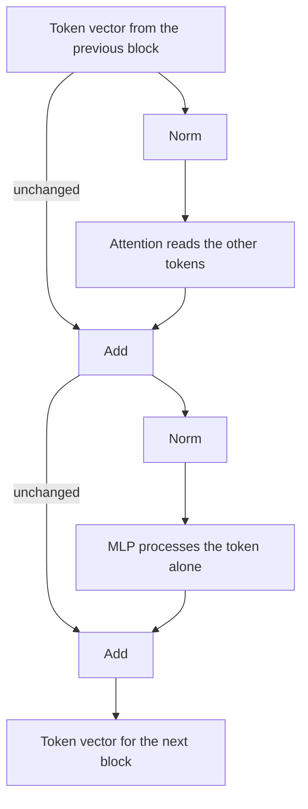

# 03. Transformer Architectures and Hyperparameters

**Level:** Practitioner · **Reading time:** 16 min · **Exercise:** 45 min
**Prerequisites:** [Resource Accounting](02-resource-accounting-flops-memory-and-arithmetic-intensity.md), for arithmetic intensity and why memory traffic decides speed.

> **In one sentence:** After this chapter you can read a modern Transformer's configuration file, recognize which choices almost every model agrees on, which ones vary, and which numbers to set by rule of thumb.

## Why this matters

You open the configuration of an open-weight model and find forty fields: `hidden_size`, `num_layers`, `num_attention_heads`, `num_key_value_heads`, `intermediate_size`, `rope_theta`, `rms_norm_eps`. Some of them barely matter. Two of them decide how big the model is and how fast it trains. One of them, if you get it wrong, makes the loss curve jump instead of falling.

How do you know which is which? CS336's answer is to look at what dozens of released models actually did, and separate the consensus from the variation.

## The core idea

A Transformer is a stack of identical **blocks**. Each block holds two parts: **attention**, which lets a token read information from other tokens, and an **MLP** (multi-layer perceptron, two or three linear layers with a nonlinearity between them), which processes each token on its own.

Both parts write into the **residual stream**: the vector that belongs to a token and is carried from the first layer to the last. A block never overwrites that vector. It computes something and adds the result on top.

```
x = x + attention(norm(x))
x = x + mlp(norm(x))
```

The analogy is a note passed down a line of people: each person adds a remark in the margin instead of rewriting the note. The analogy breaks because the additions are not small comments: later layers rely heavily on what earlier ones wrote, and the additions must keep a similar scale or the numbers grow out of control. That is the job of **normalization**, the `norm` in the sketch above.

**Figure 1.** One pre-norm block: the residual stream skips around each part, and each part only adds to it.



The two arrows labeled unchanged are the residual stream: whatever a part computes is added, never written in place of what was there.

Around this skeleton, six choices vary from model to model:

| Choice | Consensus (as of the lecture, Spring 2026) | Alternatives in use |
|---|---|---|
| Where the norm sits | Before each part, outside the residual stream (pre-norm) | After the part, still outside the stream (Grok, Gemma 2, Olmo 2); norms in both places |
| Norm type | RMSNorm | LayerNorm (GPT-1/2/3, OPT, GPT-J, BLOOM) |
| Bias terms | Dropped | Kept, as in the original Transformer |
| Activation in the MLP | Gated: SwiGLU or GeGLU | ReLU (original, T5, Gopher, Chinchilla, OPT); GeLU (GPT-1/2/3, GPT-NeoX, BLOOM) |
| Block layout | Attention, then MLP (serial) | Both at once, from the same input (GPT-J, PaLM, GPT-NeoX) |
| Position information | RoPE | Sinusoidal (original), learned absolute (GPT-1/2/3, OPT), relative (T5, Gopher, Chinchilla) |

## How it works, step by step

Take the blocks in the order a token meets them.

### 1. Normalization

**LayerNorm** subtracts the mean across the vector's dimensions, divides by the standard deviation, then scales and shifts with learned numbers. **RMSNorm** skips the mean and the shift:

`y = x / sqrt(mean(x²) + ε) · γ`

Here `x` is the token's vector, `mean(x²)` is the average of its squared entries, `ε` is a small constant that prevents division by zero, and `γ` is a learned scale per dimension.

Two placements exist:

- **Post-norm** (the original Transformer): `x = norm(x + f(x))`. The norm sits inside the stream.
- **Pre-norm**: `x = x + f(norm(x))`. The stream passes through untouched.

### 2. Attention and position

Each token produces a **query**, a **key** and a **value**. A token's query is compared with every key by a dot product. The scores pass through a softmax, which turns them into weights that sum to one, and the output is the weighted sum of the values.

Attention has no idea which token comes first. It is only dot products, so shuffling the tokens changes nothing unless position is added. Four families do that:

1. **Sinusoidal**: add a fixed pattern of sines and cosines to each token's vector.
2. **Absolute**: add a learned vector for each position.
3. **Relative**: add learned terms to the attention scores based on the distance between two tokens.
4. **RoPE** (rotary position embedding): rotate the query and key vectors by an angle that depends on position. The dot product between a query at position `i` and a key at position `j` then depends only on `i − j`.

RoPE's goal is that property: `<f(x, i), f(y, j)> = g(x, y, i − j)`, where `f` applies the rotation and `g` is some function that never sees absolute positions.

### 3. The MLP and gating

The original MLP is `max(0, xW1) W2`: project up to a wider space, apply ReLU (`max(0, z)`), project back down. A **gated** MLP adds a second projection `V` and multiplies element by element:

`FFN(x) = (Swish(xW1) ⊗ xV) W2`

`Swish(z) = z · sigmoid(z)` is a smooth version of ReLU, and `⊗` is element-wise multiplication. With Swish the variant is called SwiGLU; with GeLU it is GeGLU. Gating costs a third matrix, so gated models narrow the hidden layer to about two-thirds of the usual width.

### 4. The hyperparameters that matter

| Hyperparameter | Rule of thumb | How forgiving |
|---|---|---|
| Head dimension | Number of heads × head dimension = model width | Wide basin: many splits work |
| Aspect ratio | Model width ÷ number of layers, roughly 100 | Fix it, then scale everything; systems concerns favor width |
| MLP width | 4 × model width; about 8/3 × when gated | Standard; near-optimal for any factor from 1 to 10 |
| Vocabulary size | 30,000 to 50,000 for monolingual models (Llama 1 and 2: 32,000); 100,000 to 250,000 for multilingual and production systems | Trade-off between compression and embedding cost |

**Multi-head attention** splits the query, key and value vectors into several heads, each with its own smaller dimension. The convention is that the heads' dimensions add up to the model width, so each head has dimension `d_model / n_heads`.

The **aspect ratio** decides depth against width. When teams scale a model up or down, they usually keep this ratio fixed and grow all dimensions together.

## Worked example

A parameter counter for a dense Transformer:

```python
def count_params(d_model, n_layers, n_heads, n_kv_heads, d_ff, vocab):
    """Parameters of a dense, gated, bias-free Transformer."""
    attn = d_model * d_model * (2 + 2 * n_kv_heads / n_heads)  # Q, O, then K, V
    mlp = 3 * d_model * d_ff                                    # gate, up, down
    return int(n_layers * (attn + mlp) + 2 * vocab * d_model)  # + embedding, output

count_params(512, 8, 8, 8, 1408, 10_000)   # 35,930,112
count_params(512, 8, 8, 8, 2048, 10_000)   # 43,794,432
```

What to observe:

- The two calls differ only in MLP width: 1408 is about 8/3 of 512, 2048 is 4 × 512. The wider MLP costs about 22% more parameters for no agreed benefit.
- In this small model, 8 layers of 512 wide, the embedding and output layers are 10.2 million of 35.9 million parameters. At real scales they matter less, and they do not behave like the other parameters.
- The aspect ratio here is 512 / 8 = 64, below the rule of thumb of about 100.

## What the practitioners say

Tatsu Hashimoto admits he has always found architecture inscrutable. His method is a survey. The best way to learn is to train your own models. The second best is to learn from what others released, and that is what the lecture does ([0:00](https://www.youtube.com/watch?v=lVynu4bo1rY&t=0)). He counts 19 new dense model releases the year before ([2:00](https://www.youtube.com/watch?v=lVynu4bo1rY&t=120)); this year most new releases are mixtures of experts ([4:00](https://www.youtube.com/watch?v=lVynu4bo1rY&t=240)).

His framing of the job: an architecture has to generalize, has to train efficiently on GPUs, and has to not blow up ([4:00](https://www.youtube.com/watch?v=lVynu4bo1rY&t=240)).

On norms, his reading of the evidence is that pre-norm won because it reduces the size and frequency of gradient spikes and allows deeper networks. When stability problems appear, his advice is blunt: "sprinkle in layer norms everywhere, and that will generally improve stability" ([12:00](https://www.youtube.com/watch?v=lVynu4bo1rY&t=720)).

On RMSNorm, he gives the reason that runs through the whole course. LayerNorm is more expressive, and nothing is lost in practice by dropping that. The operation is about 0.17% of the FLOPs in his example, yet it still costs time, because FLOPs are not runtime ([14:00](https://www.youtube.com/watch?v=lVynu4bo1rY&t=840)). Small operations that move memory and add little expressive power are the first to remove.

On position, he stresses that attention by itself is a set operation: "They're just inner products. So you can just shuffle them and attention would be the same" without a position embedding ([30:00](https://www.youtube.com/watch?v=lVynu4bo1rY&t=1800)).

On hyperparameters, he ranks them. The head split is forgiving, with a wide basin around the convention; T5 and LaMDA are the exceptions ([50:00](https://www.youtube.com/watch?v=lVynu4bo1rY&t=3000)). The aspect ratio is one of the most critical, because it controls the entire depth-to-width trade-off as models grow. Most models sit near 100, about 100 units of width per layer, GPT-3 and Llama included. His explanation is a compromise between two pressures: systems reasons to go wide, because width slices easily across GPUs, and expressiveness reasons to go deep ([52:00](https://www.youtube.com/watch?v=lVynu4bo1rY&t=3120)). Anywhere near 100 is a safe bet ([54:00](https://www.youtube.com/watch?v=lVynu4bo1rY&t=3240)). The Kaplan sweep he shows softens this: as depth and width trade off, FLOPs explain most of the difference, not the ratio.

On regularization, he notes that nobody uses dropout (randomly zeroing values during training) any more, because it interacts badly with optimization. Newer models keep only weight decay, a penalty that pulls weights toward zero, which may allow a higher learning rate ([64:00](https://www.youtube.com/watch?v=lVynu4bo1rY&t=3840)).

Finally, inference pushes back on architecture. To generate cheaply, a model keeps a **KV cache**, a stored copy of the keys and values of all previous tokens. That cache grows with sequence length. **Multi-query attention** shares one key and value across all heads and shrinks the cache a lot, but, he warns, it does lose significant expressive power. **Grouped-query attention** keeps several key and value heads, fewer than the query heads, and the trade-off is quite favorable ([80:00](https://www.youtube.com/watch?v=lVynu4bo1rY&t=4800)). Chapter 08 does this arithmetic.

Stability is the third lens. As runs get more expensive, Hashimoto says, a loss that spikes can leave a model that is poor or unrecoverable ([64:00](https://www.youtube.com/watch?v=lVynu4bo1rY&t=3840)). His first suspects are the two softmaxes, at the output and in attention, because each combines an exponential with a division ([66:00](https://www.youtube.com/watch?v=lVynu4bo1rY&t=3960)). Three fixes follow:

- **Z-loss** adds a penalty on the squared log of the output softmax's normalizer, the sum that makes the probabilities add to one; the penalty is zero when the numbers are well behaved. Devlin introduced it in 2014, and DCLM and Olmo brought it back ([68:00](https://www.youtube.com/watch?v=lVynu4bo1rY&t=4080)).
- **QK-norm** normalizes the queries and keys just before their dot product, so the attention softmax sees inputs of roughly unit scale. It came from multimodal models, costs no visible performance in his reading, and is now standard ([70:00](https://www.youtube.com/watch?v=lVynu4bo1rY&t=4200)).
- **Logit soft-capping** limits the logits (the raw scores that go into a softmax) with a tanh, a function that flattens at a fixed maximum. It is a harder intervention that some teams apply ([72:00](https://www.youtube.com/watch?v=lVynu4bo1rY&t=4320)).

Long context pulls in another direction. Models built for it alternate expensive global attention layers with cheap ones: sliding-window layers that see only nearby tokens, as GPT-3 already did ([84:00](https://www.youtube.com/watch?v=lVynu4bo1rY&t=5040)), or state-space layers. Hashimoto describes these hybrids as the past year's main answer to long-context performance ([88:00](https://www.youtube.com/watch?v=lVynu4bo1rY&t=5280)); Chapter 04 covers them.

## Pitfalls

1. **Putting the norm inside the residual stream in a new model.** Post-norm needs learning-rate warmup and spikes more. Fix: start from pre-norm.
2. **Assuming low FLOPs means fast.** A norm costs almost no arithmetic and still takes time, because it reads and writes memory. Fix: count bytes moved, not only FLOPs.
3. **Going very deep to gain expressiveness.** An extremely deep model has to be split along its depth, which means pipeline parallelism that most people, Hashimoto says, do not want to deal with, while width splits easily ([52:00](https://www.youtube.com/watch?v=lVynu4bo1rY&t=3120)). Fix: stay near the common ratios, about 100, and scale width, depth and heads together.
4. **Keeping the 4× MLP width after switching to gating.** That inflates parameters. Fix: use about 8/3 × the model width.
5. **Counting embedding parameters like the rest.** They behave differently. Fix: report them separately, as the counter above does.
6. **Treating a survey as proof.** The table shows what worked for the teams that released models, under their budgets. Fix: test on your own small runs before you rely on a choice.

## Try it

Take the parameter counter and three public model cards, for example Llama 2 7B, Mistral 7B and GPT-2.

**Deliverable:** a table with, for each model, width, layers, heads, head dimension, MLP width, vocabulary and total parameters, plus the aspect ratio.

You are done when:

- Your computed parameters land within 5% of the published count for each model, after you account for anything the model has that the counter lacks.
- You can state, for each model, which row of the consensus table it departs from, if any.
- All three aspect ratios are listed and compared with the rule of about 100.

**Stretch:** add mixture-of-experts support and recompute for one sparse model, using active parameters.

## Key takeaways

- A Transformer block adds attention and MLP results to a residual stream. Almost everything else is a design choice.
- The consensus: pre-norm outside the stream, RMSNorm, no bias terms, a gated MLP, serial blocks, RoPE.
- RMSNorm wins not on FLOPs but on memory traffic. FLOPs are not runtime.
- The aspect ratio, width divided by depth, is the hyperparameter to fix before scaling. About 100 is a safe value, and stability tricks (z-loss, QK-norm) keep a long run from spiking.
- Inference needs to shape architecture: smaller KV caches through grouped-query attention, and hybrids of global and cheap layers for long context.

## Self-check

1. What is the residual stream?
   - A. The vector a token carries through the layers, which blocks add to
   - B. The gradient that flows back from the loss to the input
   - C. A cache of keys and values kept for generation
   - D. The learned vector that encodes a token's position
2. In pre-norm, where does the normalization apply?
   - A. To the sum of the stream and the block output
   - B. To the block input only, leaving the stream untouched
   - C. To the loss before the parameters update
   - D. To the embedding table once, before the first block
3. Which property makes RoPE different from absolute position embeddings?
   - A. It adds a learned vector to each token at every position
   - B. It makes attention scores depend on the distance between tokens
   - C. It works only for sequences shorter than 512 tokens
   - D. It encodes position in the MLP instead of attention
4. Why do gated models use a narrower MLP?
   - A. Gating removes one of the two matrices
   - B. Narrow layers are easier to quantize after training
   - C. Gating adds a third matrix, so width is cut to keep the size
   - D. Gated activations overflow in wide layers
5. Which hyperparameter does the lecture call one of the most critical?
   - A. The epsilon inside the norm
   - B. The ratio of model width to number of layers
   - C. The number of key-value heads in a small model
   - D. The order of operations inside the MLP

<details><summary>Show answers</summary>

1. A. Blocks add their output to it and never overwrite it.
2. B. The norm sits on the branch that feeds the block; the stream itself is not normalized.
3. B. Rotating queries and keys makes their dot product depend on the distance between positions.
4. C. The gate matrix is a third matrix, so the hidden width drops to about 8/3 of the model width.
5. B. The aspect ratio, with about 100 as a safe value.

</details>

## Sources

- **Lecture:** Tatsu Hashimoto, "Lecture 3: Architectures", Stanford CS336 Language Modeling from Scratch (Spring 2026): [video](https://www.youtube.com/watch?v=lVynu4bo1rY) · [guide](../lectures/cs336-03-architectures-hyperparameters.md), used at [survey method](https://www.youtube.com/watch?v=lVynu4bo1rY&t=0), [norms and stability](https://www.youtube.com/watch?v=lVynu4bo1rY&t=720), [FLOPs are not runtime](https://www.youtube.com/watch?v=lVynu4bo1rY&t=840), [position](https://www.youtube.com/watch?v=lVynu4bo1rY&t=1800), [aspect ratio](https://www.youtube.com/watch?v=lVynu4bo1rY&t=3000), [KV cache and GQA](https://www.youtube.com/watch?v=lVynu4bo1rY&t=4800), [hybrids](https://www.youtube.com/watch?v=lVynu4bo1rY&t=5280)
- **Reading:** Ashish Vaswani et al., "Attention Is All You Need" (2017): [arXiv](https://arxiv.org/abs/1706.03762)
- **Reading:** Noam Shazeer, "GLU Variants Improve Transformer" (2020): [arXiv](https://arxiv.org/abs/2002.05202)
- **Reading:** Ruibin Xiong et al., "On Layer Normalization in the Transformer Architecture" (2020): [arXiv](https://arxiv.org/abs/2002.04745)
- **Reading:** Biao Zhang and Rico Sennrich, "Root Mean Square Layer Normalization" (2019): [arXiv](https://arxiv.org/abs/1910.07467)
- **Reading:** Jianlin Su et al., "RoFormer: Enhanced Transformer with Rotary Position Embedding" (2021): [arXiv](https://arxiv.org/abs/2104.09864)

## Next

→ [Attention Alternatives and Mixture of Experts](04-attention-alternatives-and-mixture-of-experts.md), for the two bigger departures from this skeleton. The inference side of grouped-query attention is in [Inference](08-inference.md), and the scaling-law view of aspect ratio is in [Scaling Laws](07-scaling-laws.md).
