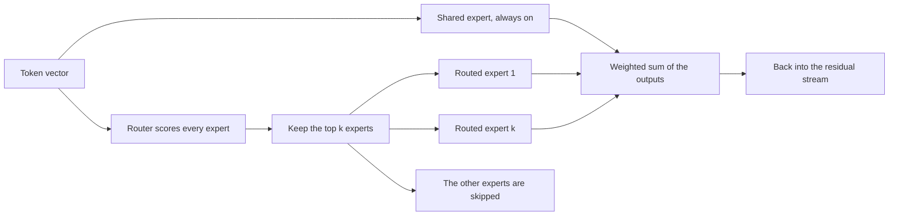

# 04. Attention Alternatives and Mixture of Experts

**Level:** Professional · **Reading time:** 15 min · **Exercise:** 60 min
**Prerequisites:** [Transformer Architectures and Hyperparameters](03-transformer-architectures-and-hyperparameters.md), for the block layout, residual stream and attention.

> **In one sentence:** After this chapter you can explain why attention gets expensive at long context, describe the four main ways to cut that cost, and say how a mixture-of-experts layer adds parameters without adding proportional compute.

## Why this matters

Two pressures shape modern architectures. Context windows keep growing, because agents need to hold long traces. And teams want models that know more, which normally means more parameters, which normally means more compute per token.

Both problems have the same root: cost per token. This chapter covers the two biggest departures from the standard Transformer block that address it: alternatives to full attention, and the mixture-of-experts layer.

## The core idea

Full attention compares every pair of tokens in a sequence. For n tokens that is about n² comparisons, while the MLP cost grows only with n. At short lengths the MLP dominates. At long lengths attention takes over ([2:00](https://www.youtube.com/watch?v=cKSwj_qZ8Jg&t=120)).

A **mixture of experts** (MoE) layer attacks the other half. Instead of one MLP per block, it holds many, called **experts**, and sends each token to only a few of them. The model has many more parameters, but each token still uses about the same number.

| Lever | What changes | What you gain |
|---|---|---|
| Kernels, the small programs that run on the chip | How attention is computed, not what it computes | A constant-factor speedup |
| Hybrid layers | Some layers use a cheaper mechanism | Cost grows more slowly with length |
| Linear attention and state-space models | Attention keeps a fixed-size state | Linear cost, no growing cache |
| Sparse attention | Each query reads a few selected tokens | Less work at long context |
| Mixture of experts | The MLP is split into routed experts | More parameters per FLOP |

## How it works, step by step

### 1. Constant factors come first

Big-O notation hides a lot. **FlashAttention** changes nothing about what attention computes. It only rearranges the computation into tiles that stay in fast on-chip memory, so far fewer bytes travel to and from main memory. The lecturer, Tatsu Hashimoto, calls it one of the biggest things that happened to attention cost, and draws the lesson that "constant factors really, really matter" ([2:00](https://www.youtube.com/watch?v=cKSwj_qZ8Jg&t=120)). Chapter 05 covers kernels.

### 2. Mix local and global layers

The simplest fix is to make most layers cheap. If only every eighth layer attends to the whole sequence and the rest see a short window of nearby tokens, the quadratic cost appears in one layer out of eight ([2:00](https://www.youtube.com/watch?v=cKSwj_qZ8Jg&t=120)).

### 3. Linear attention

Attention is `softmax(Q Kᵀ) V`, where Q, K and V are the query, key and value matrices for all tokens. The n × n matrix `Q Kᵀ` is the expensive part. Remove the softmax and the parentheses can move:

`(Q Kᵀ) V = Q (Kᵀ V)`

The product `Kᵀ V` has a fixed size. It can be built up one token at a time: `S ← S + k vᵀ` for each token, then the output for that token is `Sᵀ q`. This is a **recurrence** with a fixed-size **state**. The cost becomes linear in n, and generation needs no growing cache. Hashimoto's argument is about which number is large. In `Q Kᵀ V` the work is n² times the key dimension, and n, the context length, reaches millions. After the reorder it is n times the key dimension times the value dimension, and those are in the thousands ([6:00](https://www.youtube.com/watch?v=cKSwj_qZ8Jg&t=360)).

Where it breaks: the softmax lets a query pick one earlier token sharply. A plain sum of outer products blurs everything together, so exact recall of a detail from far back gets harder as the sequence grows.

### 4. Add a state that can forget: Mamba-2 and Gated DeltaNet

Two elaborations on linear attention make the state more useful:

- **Mamba-2** belongs to the family of **state-space models**, which keep a state that is updated at every step. It amounts to linear attention with an extra gate that depends only on the current token and decides, at each step, how much of the old state to keep. That is how it forgets ([12:00](https://www.youtube.com/watch?v=cKSwj_qZ8Jg&t=720)).
- **Gated DeltaNet** adds a second gate on the new write, and when it writes a token it first erases what the state already holds in that token's key direction ([16:00](https://www.youtube.com/watch?v=cKSwj_qZ8Jg&t=960)). Hashimoto notes that the same idea resurfaced under the names fast-weight programming and test-time training ([18:00](https://www.youtube.com/watch?v=cKSwj_qZ8Jg&t=1080)).

### 5. Sparse attention

Instead of a fixed state, keep the full key-value cache but read only part of it. **DeepSeek Sparse Attention** pairs a cheap "indexer", which scores query-key pairs, with full attention over the top-scoring tokens.

| Approach | State at generation | What it gives up |
|---|---|---|
| Full attention | Cache grows with length | Nothing, but cost grows too |
| Sliding window | Fixed size | Direct access to anything beyond the window |
| Linear attention, state-space models | Fixed size | Sharp recall of distant details |
| Sparse selection | Cache still grows; fewer reads are done | Depends on the indexer picking the right tokens |

### 6. Mixture of experts

Replace each block's MLP with E expert MLPs and a **router**, a small layer that scores every expert for each token. The token goes to the top k scorers, typically a handful, and their outputs are combined.

```python
# Illustrative pseudocode
def moe_layer(x, experts, w_router, k=2):
    scores = w_router @ x                    # one score per expert
    chosen = scores.topk(k).indices
    out = 0
    for e in chosen:
        out = out + scores[e] * experts[e](x)
    return out
```

Two numbers describe such a model: **total parameters** and **active parameters**, the part one token passes through. DeepSeek-V3, as reported in the lecture's slides, has 671B total and 37B active.

**Figure 1.** A mixture-of-experts layer: every token goes through the shared expert and only the top-k routed experts, so total parameters far exceed active parameters.



The skipped experts still count toward total parameters, but they do no work for this token, which is why the two numbers come so far apart.

Four reasons explain the popularity, all from the lecture's slides: more parameters at the same FLOPs does better, MoEs train faster, they compete with much larger dense models, and they parallelize across devices. The cost is infrastructure.

**Routing.** Almost every released MoE uses token-choice top-k, the scheme of the Switch Transformer, GShard, Grok, Mixtral, Qwen, DBRX and DeepSeek ([50:00](https://www.youtube.com/watch?v=cKSwj_qZ8Jg&t=3000)). Hashimoto finds it mysterious that even unlearned routing does something: hashing the token's vector and sending it to an expert gives gains, though smaller than top-k. Learning routes with reinforcement learning, the natural approach to a learning theorist, was tried early but is uncommon, he says, because the RL adds overhead and randomness ([50:00](https://www.youtube.com/watch?v=cKSwj_qZ8Jg&t=3000)). An exact global assignment can be solved, but it is far too expensive to scale. Top-k is the consensus, and there is no reason to do something much more complicated ([52:00](https://www.youtube.com/watch?v=cKSwj_qZ8Jg&t=3120)).

**Fine-grained experts plus shared experts.** The DeepSeek style cuts the experts into smaller pieces and keeps one or a few always on, outside the router. Hashimoto's explanation: in the classic design many experts were reusing weights for the same common processing. The shared expert takes that over and lets the routed experts specialize ([54:00](https://www.youtube.com/watch?v=cKSwj_qZ8Jg&t=3240)). DeepSeek's ablation compares 16 routed experts with no shared one, the GShard design, against fine-grained experts plus one shared expert. Both changes help, the shared expert visibly on TriviaQA and Natural Questions. Olmo's controlled study agrees on fine-grained experts but finds that shared experts help very little ([56:00](https://www.youtube.com/watch?v=cKSwj_qZ8Jg&t=3360)). In his telling, the DeepSeek design became the template others copy, as the Llama design did for dense models.

**Training.** Choosing top-k is an all-or-nothing decision, so gradients do not flow through the choice itself. Two workarounds:

- Make routing noisy, as with the Gaussian perturbation of Shazeer et al. (2017) or the multiplicative jitter of Fedus et al. (2022).
- Add a **load-balancing loss** that penalizes uneven expert usage, because hardware is wasted when a few experts receive everything.

Hashimoto reads the Switch Transformer's balancing loss through its gradient. For each expert it multiplies the fraction of tokens sent to it by the router's probability mass on it, so the more tokens an expert attracts, the harder its probability is pushed down ([64:00](https://www.youtube.com/watch?v=cKSwj_qZ8Jg&t=3840)). DeepSeek-V3 replaces the loss with a per-expert bias that is updated online to steer tokens toward underused experts. Hashimoto's wish is plain: "I wish I could just get rid of the load balancing loss" ([68:00](https://www.youtube.com/watch?v=cKSwj_qZ8Jg&t=4080)). Olmo's ablation shows why it stays: without the loss, almost every token goes to two experts, the rest sit idle, and the training loss climbs.

**Systems.** Experts sit on different devices, so a token may have to travel. Expert parallelism adds a third axis once data parallelism has hit its batch-size limit and model parallelism has run out of places to cut. The computation also maps onto the structured sparse matrix multiplies that GPUs support natively ([72:00](https://www.youtube.com/watch?v=cKSwj_qZ8Jg&t=4320)). Nemotron 3 shrinks the activations before sending them: it down-projects the residual stream first, so the routed experts work on a smaller vector while the shared expert, which is never sent, keeps the full size ([74:00](https://www.youtube.com/watch?v=cKSwj_qZ8Jg&t=4440)).

## Worked example

How many parameters does an MoE layer add, and how many does one token use?

```python
def moe_params(d_model, d_ff, n_routed, n_shared, k):
    """MLP parameters per layer: total, and the part one token uses."""
    one = 3 * d_model * d_ff                 # gated expert: gate, up, down
    total = (n_routed + n_shared) * one
    active = (k + n_shared) * one
    return total, active

total, active = moe_params(1024, 2816, 32, 1, 2)
dense = 3 * 1024 * 2816
total / dense      # 33
active / dense     # 3
```

What to observe:

- The layer holds 33 times the MLP parameters of the dense version, 285 million against 8.7 million.
- A token uses three experts, the top two plus the shared one, so it does three times the MLP work.
- With attention unchanged, the block's parameter count jumped far more than its compute. That is the whole trick.

## What the practitioners say

The lecture's headline on linear attention is a warning. MiniMax M1 and MiniMax-Text-01 use a 7-to-1 hybrid, seven linear layers per full attention layer, and Hashimoto calls its performance strong. He adds: "no one has thus far really proven out fully linear time attention mechanisms at scale" ([10:00](https://www.youtube.com/watch?v=cKSwj_qZ8Jg&t=600)). Everything he shows is a hybrid.

The examples he gives: Nemotron 3 mixes Mamba layers and attention at roughly 3 to 1, and Qwen 3.5 and Qwen Next are 3-to-1 hybrids of gated DeltaNet and attention. Qwen Next decodes with much higher throughput than Qwen 3 as context grows, and the hybrid costs little performance in his comparison. His caveat is that controlled studies are few. One, from ByteDance Seed and UC Santa Cruz, increases the number of non-attention layers from left to right: performance degrades, but for the best variants there is basically no hit at low ratios ([18:00](https://www.youtube.com/watch?v=cKSwj_qZ8Jg&t=1080)).

On MoE stability, he points to the router **z-loss** from Zoph et al. (2022), and to spiky training curves when it is removed ([78:00](https://www.youtube.com/watch?v=cKSwj_qZ8Jg&t=4680)). Two more warnings come from the lecture. Sparse MoEs overfit badly when their experts are fine-tuned on small datasets: train and validation loss separate sharply on a GLUE task in his plot. The fixes are to fine-tune only the non-expert MLPs or only attention, or to use far more data, 1.4 million examples in his figure ([78:00](https://www.youtube.com/watch?v=cKSwj_qZ8Jg&t=4680)). Early MoE infrastructure added randomness of its own: a popular expert's queue overflowed, tokens were silently dropped, and other users' queries could change your output. He calls that solved by drop-free architectures such as MegaBlocks ([74:00](https://www.youtube.com/watch?v=cKSwj_qZ8Jg&t=4440), [76:00](https://www.youtube.com/watch?v=cKSwj_qZ8Jg&t=4560)).

**Upcycling** is a cheaper way to start: copy a trained dense model into an MoE and continue training. The slides list MiniCPM (top-2 of 8 experts, about 4B active) and an early Qwen MoE (built from the 1.8B model, top-4 of 60, with 4 shared). It has fallen out of use: Hashimoto has not seen a single upcycled model in the year of the lecture ([78:00](https://www.youtube.com/watch?v=cKSwj_qZ8Jg&t=4680)).

He closes with the DeepSeek line as a lesson in evolution ([82:00](https://www.youtube.com/watch?v=cKSwj_qZ8Jg&t=4920)). Version 1 already had shared and fine-grained experts, top-k routing and a standard balancing loss; he calls it the platonic ideal of an MoE. Version 2, at 236B total and 21B active, added device routing and auxiliary losses that balance devices and communication. His reading: successful training is not only deep learning, it is also about respecting your systems. Version 3 kept the expert design and switched to balancing without an auxiliary loss.

Two extra pieces of V3 get a mention. **Multi-head latent attention** stores a compressed vector per token instead of full keys and values (Chapter 08 covers it). **Multi-token prediction** trains the model to predict several future tokens at once, which gives it a built-in speculative decoder, an idea he admires but says has not caught on ([84:00](https://www.youtube.com/watch?v=cKSwj_qZ8Jg&t=5040)).

His summary: MoEs exploit sparsity so that you have more parameters than you pay compute for, very simple routing works even at scale, and MoEs are here to stay ([84:00](https://www.youtube.com/watch?v=cKSwj_qZ8Jg&t=5040), [86:00](https://www.youtube.com/watch?v=cKSwj_qZ8Jg&t=5160)).

## Pitfalls

1. **Judging by big-O alone.** A well-engineered quadratic kernel beats a poorly engineered linear one. Fix: profile before you change architecture.
2. **Expecting exact recall from a fixed state.** Fix: keep some full attention layers, as every shipped hybrid does.
3. **Comparing an MoE by total parameters.** Fix: compare active parameters and FLOPs per token.
4. **Letting load drift.** A few experts take everything and the rest are dead weight. Fix: add a balancing loss or a bias update, and watch expert usage.
5. **Dropping the router z-loss.** Fix: keep it until a long run proves you do not need it.
6. **Fine-tuning an MoE on a small dataset.** Fix: fine-tune only the non-expert MLPs or the attention, as Zoph et al. did, or use far more data.
7. **Forgetting communication.** Expert parallelism trades compute for network traffic. Fix: count bytes between devices, as in Chapter 06.

## Try it

Use the `moe_params` function.

**Deliverable:** a table for four configurations: 8 experts with top-1, 32 with top-2, 64 with top-6, and each with one shared expert.

You are done when:

- For each row you report total parameters, active parameters and the two ratios against the dense layer.
- One sentence states how the ratios change as the number of experts grows with k fixed.
- A second paragraph explains, in three sentences, why a 3-to-1 hybrid of state-space and attention layers avoids the recall weakness of a pure state-space model.

**Stretch:** write a toy router in pure Python that assigns 1,000 random tokens to 8 experts, print the usage per expert, and add a penalty term that pushes usage toward even.

## Key takeaways

- Attention cost grows with the square of context length; MLP cost grows linearly.
- Kernels give constant-factor wins. Hybrids, linear attention and sparse attention change how cost grows.
- No purely linear-time attention has been proven at scale. Shipped models mix cheap layers with a few full attention layers.
- An MoE replaces the MLP with many experts and a top-k router: many parameters, few active per token.
- MoE training needs load balancing and stability tricks, and MoE serving needs communication-aware systems.

## Self-check

1. What makes linear attention linear in sequence length?
   - A. It samples a fixed number of keys for every query
   - B. It drops the softmax, so the product can go through a small fixed state
   - C. It limits every token to a fixed window of neighbors
   - D. It compresses the keys and values into fewer dimensions
2. What do all the large-scale "linear" models in the lecture have in common?
   - A. They drop the MLP from every layer
   - B. They keep some full attention layers
   - C. They use only eight layers in total
   - D. They train without a learning-rate schedule
3. A MoE layer has 64 experts and routes each token to 6. What grows compared with the dense version?
   - A. Compute per token only
   - B. Parameters only
   - C. Both parameters and compute, by different factors
   - D. Neither
4. Why does MoE training need a load-balancing mechanism?
   - A. Gradients cannot flow through the top-k choice
   - B. Left alone, routing concentrates on a few experts and wastes hardware
   - C. Experts are placed on the same device as the router
   - D. The shared experts must receive no tokens
5. What does DeepSeek-V3 use instead of a load-balancing loss?
   - A. Reinforcement learning over routes
   - B. Gaussian noise added to the router
   - C. A per-expert bias updated online
   - D. Uniform random routing every other step

<details><summary>Show answers</summary>

1. B. `Q (Kᵀ V)` builds a fixed-size state, so the work per token does not grow with length.
2. B. Every example in the lecture is a hybrid, such as 7 to 1 or 3 to 1.
3. C. Parameters grow with the number of experts, compute with k plus shared experts.
4. B. Balance keeps every device busy. The top-k choice is the reason for noise and jitter, not for balancing.
5. C. A bias adjusted online steers tokens toward underused experts.

</details>

## Sources

- **Lecture:** Tatsu Hashimoto, "Lecture 4: Attention Alternatives", Stanford CS336 Language Modeling from Scratch (Spring 2026): [video](https://www.youtube.com/watch?v=cKSwj_qZ8Jg) · [guide](../lectures/cs336-04-attention-alternatives-and-mixture-of-experts.md), used at [attention cost](https://www.youtube.com/watch?v=cKSwj_qZ8Jg&t=120), [hybrids at scale](https://www.youtube.com/watch?v=cKSwj_qZ8Jg&t=600), [routing](https://www.youtube.com/watch?v=cKSwj_qZ8Jg&t=3000), [load balancing](https://www.youtube.com/watch?v=cKSwj_qZ8Jg&t=4080), [DeepSeek line](https://www.youtube.com/watch?v=cKSwj_qZ8Jg&t=4920), [summary](https://www.youtube.com/watch?v=cKSwj_qZ8Jg&t=5040)
- **Reading:** William Fedus, Jeff Dean and Barret Zoph, "A Review of Sparse Expert Models in Deep Learning" (2022): [arXiv](https://arxiv.org/abs/2209.01667)
- **Reading:** Noam Shazeer et al., "Outrageously Large Neural Networks: The Sparsely-Gated Mixture-of-Experts Layer" (2017): [arXiv](https://arxiv.org/abs/1701.06538)
- **Reading:** William Fedus, Barret Zoph and Noam Shazeer, "Switch Transformers: Scaling to Trillion Parameter Models with Simple and Efficient Sparsity" (2021): [arXiv](https://arxiv.org/abs/2101.03961)
- **Reading:** Tri Dao and Albert Gu, "Transformers are SSMs: Generalized Models and Efficient Algorithms Through Structured State Space Duality" (2024): [arXiv](https://arxiv.org/abs/2405.21060)
- **Reading:** DeepSeek-AI, "DeepSeek-V3 Technical Report" (2024): [arXiv](https://arxiv.org/abs/2412.19437)

## Next

→ [GPUs, TPUs and Kernels](05-gpus-tpus-and-kernels.md), for the hardware side that makes constant factors matter. The inference view of the KV cache is in [Inference](08-inference.md), and running experts on many devices is in [Parallelism](06-parallelism.md).
