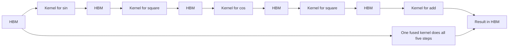

# 05. GPUs, TPUs and Kernels

**Level:** Professional · **Reading time:** 16 min · **Exercise:** 60 min
**Prerequisites:** [Resource Accounting](02-resource-accounting-flops-memory-and-arithmetic-intensity.md), for arithmetic intensity and the memory-bound versus compute-bound distinction.

> **In one sentence:** After this chapter you can describe a GPU's memory hierarchy, say what a kernel is and why speed is mostly about moving fewer bytes, and read a simple Triton kernel.

## Why this matters

Two teams implement the same Transformer. One trains at 45% of the hardware's peak speed, the other at 15%. Same model, same chips. The difference is in the kernels: the small programs that run on the GPU.

Tatsu Hashimoto opens Lecture 5 with a promise. He shows a plot of matrix-multiplication throughput against matrix size, full of jumps and dips: at certain sizes matmuls are much slower than at others. By the end of the lecture, he promises, you will understand why ([0:00](https://www.youtube.com/watch?v=izZba4UA7iY&t=0)). CUDA is NVIDIA's programming language for GPUs.

## The core idea

A CPU is built to run a few threads as fast as possible. A GPU is built to run thousands of threads at once, each slow. It is organized as many **streaming multiprocessors** (SMs), each with its own small, fast memory, all fed by one large, slow memory.

The numbers for an H100, from Lecture 6's table:

| Memory | Size | Bandwidth |
|---|---|---|
| Registers, inside each SM | 256 KB per SM | About 401 TB/s |
| L1 cache and shared memory, inside each SM | 256 KB per SM | About 33 TB/s |
| L2 cache, shared by the chip | 50 MB | About 12 TB/s |
| High bandwidth memory (HBM), the GPU's main memory | 80 GB | 3.35 TB/s |

Each row down is slower: about ten times from registers to shared memory, then three to four times per row. So the rule of the whole unit is: move as little data as possible down to HBM and back. Hashimoto's summary of the machine: massively parallel, with compute scaling faster than memory, so everything must respect the memory hierarchy ([26:00](https://www.youtube.com/watch?v=izZba4UA7iY&t=1560)).

Lecture 5's analogy is a factory: a memory warehouse, a compute workshop and a conveyor belt between them ([46:00](https://www.youtube.com/watch?v=izZba4UA7iY&t=2760)). Every trip to the warehouse costs time. The analogy breaks in one place: a real factory can stock a shelf once and forget it. A GPU's fast memory is so small that a program must keep refilling it, in an order that avoids repeated trips.

A **kernel** is the function that runs on the GPU. When PyTorch executes an operation such as `a + b`, it launches a kernel. A program that adds, then multiplies, then applies an activation launches three kernels and visits HBM after each one.

## How it works, step by step

### 1. The programming model

- A **thread** runs the kernel's code on one small piece of the data.
- A **thread block** is a group of threads that share memory. A block runs on one SM.
- The **grid** is all the blocks of one kernel launch.

Blocks exist because some operations need threads to cooperate. Adding two vectors needs no cooperation: one thread per element. A matrix product needs threads to share the inputs, so they must live on the same SM.

### 2. The hardware facts that decide speed

| Fact | What it means | What goes wrong |
|---|---|---|
| Warps | Threads run in groups of 32 that execute the same instruction at the same time | If threads in a group take different branches, the branches run one after another (control divergence) |
| Occupancy | Each thread uses up to 255 registers; the more it uses, the fewer threads fit on an SM | Too few threads leave the SM idle while it waits for memory |
| Bank conflicts | Shared memory has 32 banks; one access per bank per cycle | Threads that hit the same bank wait in line |
| Coalescing | The 32 threads of a group fetch memory in 128-byte lines | Threads that read scattered addresses fetch mostly unused bytes |
| Waves | Blocks are scheduled onto SMs in rounds | On a B200 (148 SMs), 160 blocks leave a last round of 12 blocks and 136 idle SMs |

Hashimoto's warning about this table is that the programming model promises correctness if you ignore all of it. Performance does not forgive. Liang works two of the rows in Lecture 6. Occupancy: a block of 128 threads that each use 160 registers needs about 20,000 registers, so only three such blocks fit in a B200 SM's 65,000. That is 12 warps out of a maximum of 64, an occupancy of about 18% ([12:00](https://www.youtube.com/watch?v=xnDHaNUvHBg&t=720)). Wave quantization explains the biggest dip in Hashimoto's opening plot. With tiles of 256 by 128, a matrix of size 1792 yields 98 tiles and size 1793 yields 120. An A100 has 108 SMs, so 98 tiles fit in one round, while 120 need a second round for the last 12, and most of the GPU sits idle ([68:00](https://www.youtube.com/watch?v=izZba4UA7iY&t=4080)).

Bank conflicts get the same treatment in Lecture 6 ([14:21](https://www.youtube.com/watch?v=xnDHaNUvHBg&t=861)). The hardware divides shared memory into 32 banks of four bytes each, and in one clock cycle no bank can serve more than a single thread. The worst case is 32 threads that all read the first column of a matrix: a 32-way conflict, in which every access waits for the one before it. Going by rows would prevent it, but Liang calls that unavoidable in a matrix product, which has to take rows from the first matrix and columns from the second, sometimes after a transpose, so the order of travel cannot always be chosen. Element-wise operations alone can go in any order. Liang names the remedy without developing it: **swizzling**, an arrangement of shared memory that keeps a kernel out of conflicts. The profiler, he adds, shows bank conflicts and occupancy.

### 3. Six tricks

Lecture 5 builds speed from a list of six tricks ([32:00](https://www.youtube.com/watch?v=izZba4UA7iY&t=1920)).

1. **Fewer branches.** All the threads of a warp execute the same instruction, so an `if` runs both branches and threads on the wrong side idle.
2. **Lower precision.** Fewer bits per value means fewer bytes to move and faster matrix units. Hashimoto calls it one of the most important tricks and the place where NVIDIA invests the most hardware effort ([34:00](https://www.youtube.com/watch?v=izZba4UA7iY&t=2040)).
3. **Fusion.** One kernel does several operations and never writes the intermediates to HBM. His example is `sin²(x) + cos²(x)`: five operations, each a kernel that reads from and writes to global memory. Fused, the data is read once and written once. `torch.compile` and JAX's compiler fuse cases this simple automatically ([48:00](https://www.youtube.com/watch?v=izZba4UA7iY&t=2880)).
4. **Recomputation.** Throw away an intermediate result and calculate it again later, instead of storing and reloading it. For three stacked sigmoids, the lecture's example needs eight memory reads and writes when it saves every activation and five when it recomputes ([50:00](https://www.youtube.com/watch?v=izZba4UA7iY&t=3000), [52:00](https://www.youtube.com/watch?v=izZba4UA7iY&t=3120)).
5. **Coalescing.** Arrange for neighboring threads to read neighboring addresses, so one memory transaction serves all 32 threads of a warp ([56:00](https://www.youtube.com/watch?v=izZba4UA7iY&t=3360)).
6. **Tiling.** Cut a large matrix product into small blocks that fit in shared memory, so each input is loaded from HBM once and reused many times. He saves it for last as the big one, maybe the most important idea ([56:00](https://www.youtube.com/watch?v=izZba4UA7iY&t=3360)).

**Figure 1.** Fusion: five operations as five kernels that each go to main memory and back, or as one kernel that reads once and writes once.



The upper path visits HBM after every step; the lower path visits it twice, which is why a chain of cheap operations is slow on a GPU.

### 4. Tiling, the big one

In a naive product of two n × n matrices, each of the n² outputs reads a row of one input and a column of the other. Every input value travels from HBM n times. With tiles of side t, a value is read n/t times from HBM and reused t times from shared memory, a t-fold reduction in global memory traffic ([60:00](https://www.youtube.com/watch?v=izZba4UA7iY&t=3600)).

Tiles also explain why odd sizes hurt. Shift the matrix size by one and the tiles no longer line up with the memory burst sections, so reading one tile costs two tiles' worth of reads. Padding lines them up again. Karpathy's nanoGPT speedrun gained 25% by raising the vocabulary size from 50,257 to 50,304, which Hashimoto offers as his favorite strange example ([64:00](https://www.youtube.com/watch?v=izZba4UA7iY&t=3840)).

### 5. Triton

Two ways exist to write a kernel. In CUDA you say what each thread does. In **Triton**, you say what each thread block does, and the compiler handles the threads. The pattern is always the same: load into shared memory, compute, write back once.

```python
# Illustrative pseudocode for the Triton API (not run)
import triton
import triton.language as tl

@triton.jit
def add_kernel(x_ptr, y_ptr, out_ptr, n, BLOCK: tl.constexpr):
    pid = tl.program_id(0)                       # which block am I
    offs = pid * BLOCK + tl.arange(0, BLOCK)     # the elements this block owns
    mask = offs < n                              # ignore the tail past the end
    x = tl.load(x_ptr + offs, mask=mask)         # one read from HBM
    y = tl.load(y_ptr + offs, mask=mask)
    tl.store(out_ptr + offs, x + y, mask=mask)   # one write to HBM
```

Liang calls Triton generally powerful enough, especially when getting started ([38:00](https://www.youtube.com/watch?v=xnDHaNUvHBg&t=2280)). Triton compiles the kernel to PTX, an assembly language for GPUs.

His softmax example shows how to choose the block when values have to be combined, in the case where one row fits in a block ([58:05](https://www.youtube.com/watch?v=xnDHaNUvHBg&t=3485)). PyTorch's naive version first takes the largest value of every row, to keep the arithmetic stable, then subtracts it, exponentiates, adds up and divides. Each of those steps launches its own kernel and goes to HBM to read and to write, so the whole matrix travels five times in and three times out, where much less would do. In Triton each row becomes one block, because a row is normalized and summed on its own, so blocks do not interact and need no shared memory. The block is as wide as the row, with the width taken up to the next power of two, and there is one block per row. The kernel receives the pointers and the strides, and positions beyond the row are masked and given the value negative infinity, which contributes nothing. What is left is the plain sequence of operations: find the maximum, subtract, exponentiate, sum, divide, store. When a whole row fits into one block, he says, a Triton kernel reads almost like ordinary PyTorch. A softmax down a column needs only a change of stride.

### 6. TPUs

A **TPU** is Google's accelerator. Hashimoto's point is that designing an energy-efficient machine-learning chip brings you to the same place either way: lightweight control, a large matrix-multiply unit, fast local memory, slow main memory. A GPU's tensor core, the circuit that multiplies small matrix blocks, maps almost exactly onto a TPU's matrix unit. The real difference between the two, in his words, is networking, not the chips themselves ([18:00](https://www.youtube.com/watch?v=izZba4UA7iY&t=1080)).

One naming trap: on a TPU, tensor core means a processor, the counterpart of an SM, while on a GPU it means the matrix-multiply unit. Comparably sized chips take opposite paths. A GPU has many small matrix units, 528 in his comparison, and a TPU a few large ones, 8. That gives the GPU more flexibility and locks the TPU into big matrix multiplies; a batch-size sweep in one of his papers stopped at 64 because the TPU's unit refused anything smaller ([20:00](https://www.youtube.com/watch?v=izZba4UA7iY&t=1200)).

### 7. FlashAttention, the tricks together

Attention computes three matrix products with a softmax in between. Naively, the n × n table of attention scores is written to HBM. FlashAttention avoids that:

- It tiles the products.
- It computes the softmax incrementally over tiles, keeping only running sums, and corrects them whenever a larger score appears ([74:00](https://www.youtube.com/watch?v=izZba4UA7iY&t=4440)).
- It fuses everything into one kernel.
- In the backward pass it recomputes instead of storing the n × n table ([76:00](https://www.youtube.com/watch?v=izZba4UA7iY&t=4560)).

The result, Hashimoto notes, is a single cleverly fused kernel in place of PyTorch's naive attention, with a dramatic improvement in serving latency ([72:00](https://www.youtube.com/watch?v=izZba4UA7iY&t=4320)).

## Worked example

How much does tiling save in bytes?

```python
def bytes_from_hbm(n, tile=None):
    """Bytes read from main memory for an n x n times n x n product in bf16."""
    reads = 2 * n ** 3 if tile is None else 2 * n ** 3 // tile
    return reads * 2

bytes_from_hbm(4096)          # about 275 GB
bytes_from_hbm(4096, 128)     # about 2.1 GB
```

What to observe:

- The naive version reads each input value 4,096 times: about 275 GB from HBM, for a result that is 32 MB.
- Tiles of 128 cut that to about 2.1 GB, 128 times less.
- The arithmetic is unchanged: 2 × 4096³, about 1.4 × 10¹¹ FLOPs. Naive, that is half a FLOP per byte, deep in memory-bound territory. With tiles of 128 it is 64 FLOPs per byte, still below an H100's 295; it takes tiles of about 1,024 to cross that line.

## What the practitioners say

Hashimoto introduces himself on the topic with "you know I am not a systems person, surprise" ([2:00](https://www.youtube.com/watch?v=izZba4UA7iY&t=120)). His argument for learning it anyway is that compute has grown far faster than memory bandwidth and inter-GPU bandwidth, so the share of optimization that is about memory keeps growing ([26:00](https://www.youtube.com/watch?v=izZba4UA7iY&t=1560)).

On tiling he calls it the big one, maybe the most important idea, and notes that distributed strategies such as data and tensor parallelism are tiling ideas seen from farther away ([56:00](https://www.youtube.com/watch?v=izZba4UA7iY&t=3360), [60:00](https://www.youtube.com/watch?v=izZba4UA7iY&t=3600)). His closing wish is that you understand reasons rather than copy numbers: "I don't want you guys to be the kind of people that cargo cult" ([76:00](https://www.youtube.com/watch?v=izZba4UA7iY&t=4560)).

Percy Liang's Lecture 6 turns to practice. His recipe for success: benchmark and profile your code, make changes, then benchmark and profile again ([22:00](https://www.youtube.com/watch?v=xnDHaNUvHBg&t=1320)). Benchmarking gives wall-clock time for an operation, which is enough to compare implementations. Profiling shows which kernels ran and for how long. The kernel's name is informative: a name containing `cutlass` and `sm100` means NVIDIA's linear-algebra library and the Blackwell architecture ([28:00](https://www.youtube.com/watch?v=xnDHaNUvHBg&t=1680)).

His case study is the GeLU activation, with three contestants: a naive PyTorch version, the built-in one, and the naive function passed through `torch.compile`. The naive one is slowest. The built-in one is fastest, and the compiled one, a Triton kernel, is much faster than naive but not quite as fast as built-in ([32:00](https://www.youtube.com/watch?v=xnDHaNUvHBg&t=1920)). The profiler shows why: each primitive of the naive expression becomes its own kernel, an add, a tanh and so on, and every kernel reads from and writes back to HBM.

Two cautions from him. The hardware is "a lot messier than the programming model" ([20:00](https://www.youtube.com/watch?v=xnDHaNUvHBg&t=1200)). And everything on the GPU runs asynchronously, so a timer must record its end event and synchronize before it reads the clock ([24:00](https://www.youtube.com/watch?v=xnDHaNUvHBg&t=1440)).

A practitioner's short version of the same lesson comes from Yann Dubois, who gives a systems overview in a Berkeley course on agents ([89:00](https://www.youtube.com/watch?v=r1qZpYAmqmg&t=5340)). A GPU's matrix-multiplication cores are around ten times faster than its other floating-point operations. In a Transformer, matrix multiplication takes most of the FLOPs but only about two-thirds of the running time, while element-wise operations and normalization take few FLOPs and a large amount of time. The score to maximize is the **model FLOP utilization** (MFU), the throughput a run achieves over the hardware's theoretical best, as [Resource Accounting: FLOPs, Memory and Arithmetic Intensity](02-resource-accounting-flops-memory-and-arithmetic-intensity.md) defines it. Fifty percent is in really good shape, he says, and even big companies may be working to get above 15 or 20%. His list of optimizations is the one in this chapter: lower precision, fusion, which `torch.compile` performs, tiling, and, in FlashAttention, recomputation, whose first version he credits with a 1.7× end-to-end speed-up ([104:00](https://www.youtube.com/watch?v=r1qZpYAmqmg&t=6240)).

## Pitfalls

1. **Timing without a warm-up and a synchronize.** Fix: run the operation a few times, synchronize, then time.
2. **Optimizing before profiling.** Fix: profile first, and work on the kernel that takes the most time.
3. **Chains of small operations.** Each one is a separate kernel and a trip to HBM. Fix: fuse, or use a compiled path.
4. **Odd shapes.** Sizes that miss tile boundaries waste work, and leftover blocks leave SMs idle. Fix: pad to multiples of common tile sizes.
5. **Cutting precision blindly.** Fix: check accuracy after every change of data type.
6. **Writing CUDA when Triton would do.** Fix: start with the block-level view.
7. **Forgetting launch overhead.** Thousands of tiny kernels can spend more time launching than computing.

## Try it

Run this on any machine with PyTorch. A GPU is better; a CPU shows the same effect more slowly. Two helpers do the timing and the profiling; `fn` is the function to measure, the plain expression or its `torch.compile` version.

```python
# Illustrative snippet for the PyTorch API (not run)
import time, torch
from torch.profiler import profile, ProfilerActivity

def time_it(fn, iters=10):
    sync = torch.cuda.synchronize if torch.cuda.is_available() else lambda: None
    for _ in range(3):                     # warm-up, so lazy compilation is not timed
        fn()
    sync()
    t0 = time.perf_counter()
    for _ in range(iters):
        fn()
    sync()                                 # wait for the GPU before reading the clock
    return (time.perf_counter() - t0) / iters

acts = [ProfilerActivity.CPU] + ([ProfilerActivity.CUDA] if torch.cuda.is_available() else [])
with profile(activities=acts) as prof:
    fn()
print(prof.key_averages().table(sort_by="self_cpu_time_total", row_limit=8))
```

**Deliverable:** a script that times two implementations of `x³ + tanh(x)`: one written as ordinary PyTorch operations, one as a compiled function.

You are done when:

- Both agree on the output to within floating-point error on a tensor of one million elements.
- The script warms up, synchronizes and averages at least ten runs.
- It reports the time of each, and a profiler table listing the kernels each one launches.
- A comment explains the difference in one or two sentences, using the words "fusion" and "HBM".

**Stretch:** write the Triton add kernel from this chapter, test it against PyTorch's `+`, and time it.

## Key takeaways

- A GPU is many slow threads with a steep memory hierarchy. Speed comes from moving fewer bytes, not from doing more arithmetic.
- A kernel is a function launched as a grid of thread blocks. PyTorch launches one per operation.
- The tools are fewer branches, lower precision, fusion, recomputation, coalescing and tiling.
- Triton lets you write a kernel at the level of thread blocks: load, compute, write back.
- Benchmark to compare, profile to see where time goes, and repeat.

## Self-check

1. Why is shared memory important to a kernel?
   - A. It is the only memory large enough for model weights
   - B. It sits inside the SM and is much faster than main memory
   - C. It is shared between different GPUs
   - D. It holds the kernel's source code
2. What does operator fusion remove?
   - A. Floating-point operations inside the matrix product
   - B. Round trips of intermediate results to main memory
   - C. The need for thread blocks
   - D. The memory hierarchy itself
3. In a tiled matrix product with tiles of side t, how many times is each input read from main memory?
   - A. Once
   - B. t times
   - C. n over t times
   - D. n squared times
4. What does a profiler tell you that a benchmark does not?
   - A. The total wall-clock time
   - B. Which kernels ran and how long each took
   - C. The model's validation loss
   - D. The number of parameters
5. What is the unit of programming in Triton?
   - A. A single thread
   - B. A warp
   - C. A thread block
   - D. A whole node

<details><summary>Show answers</summary>

1. B. It is on the SM, an order of magnitude faster than HBM, and shared by a block's threads.
2. B. One kernel computes several steps and keeps intermediates on the chip.
3. C. n/t times from HBM, then t reuses from shared memory.
4. B. Benchmarks give end-to-end time; profiles break it down by kernel.
5. C. You describe what a block does with its piece of the data.

</details>

## Sources

- **Lecture:** Tatsu Hashimoto, "Lecture 5: GPUs, TPUs", Stanford CS336 Language Modeling from Scratch (Spring 2026): [video](https://www.youtube.com/watch?v=izZba4UA7iY) · [guide](../lectures/cs336-05-gpus-tpus.md), used at [motivation](https://www.youtube.com/watch?v=izZba4UA7iY&t=120), [TPUs](https://www.youtube.com/watch?v=izZba4UA7iY&t=1080), [memory wall](https://www.youtube.com/watch?v=izZba4UA7iY&t=1560), [tiling](https://www.youtube.com/watch?v=izZba4UA7iY&t=3600), [closing](https://www.youtube.com/watch?v=izZba4UA7iY&t=4560)
- **Lecture:** Percy Liang, "Lecture 6: Kernels, Triton, XLA", Stanford CS336 Language Modeling from Scratch (Spring 2026): [video](https://www.youtube.com/watch?v=xnDHaNUvHBg) · [guide](../lectures/cs336-06-kernels-triton.md), used at [hardware](https://www.youtube.com/watch?v=xnDHaNUvHBg&t=120), [messier than the model](https://www.youtube.com/watch?v=xnDHaNUvHBg&t=1200), [profiling](https://www.youtube.com/watch?v=xnDHaNUvHBg&t=1320), [bank conflicts](https://www.youtube.com/watch?v=xnDHaNUvHBg&t=861), [softmax in Triton](https://www.youtube.com/watch?v=xnDHaNUvHBg&t=3485)
- **Lecture:** Yann Dubois, "LLM Agents Overview", UC Berkeley Agentic AI MOOC (Fall 2025, CS 294/196): [video](https://www.youtube.com/watch?v=r1qZpYAmqmg) · [guide](../lectures/f25-01-llm-agents-overview.md), used at [systems overview](https://www.youtube.com/watch?v=r1qZpYAmqmg&t=5340)
- **Reading:** Jacob et al., "How to Scale Your Model": [book](https://jax-ml.github.io/scaling-book/)
- **Reading:** Philippe Tillet, Hsiang-Tsung Kung and David Cox, "Triton: An Intermediate Language and Compiler for Tiled Neural Network Computations" (MAPL 2019): [paper](https://doi.org/10.1145/3315508.3329973)
- **Reading:** Tri Dao, Daniel Y. Fu et al., "FlashAttention: Fast and Memory-Efficient Exact Attention with IO-Awareness" (2022): [arXiv](https://arxiv.org/abs/2205.14135)
- **Reading:** Maxim Milakov and Natalia Gimelshein, "Online Normalizer Calculation for Softmax" (2018): [arXiv](https://arxiv.org/abs/1805.02867)

## Next

→ [Parallelism](06-parallelism.md), which applies the same principle one level up: moving less data between GPUs. For how kernels appear in the course's second assignment, see [Building Your Own](13-building-your-own-a-roadmap-through-the-assignments.md).
