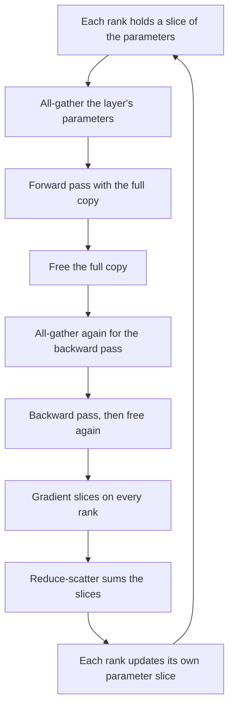

# 06. Parallelism

**Level:** Professional · **Reading time:** 15 min · **Exercise:** 45 min
**Prerequisites:** [GPUs, TPUs and Kernels](05-gpus-tpus-and-kernels.md), for the single-GPU picture, and [Resource Accounting](02-resource-accounting-flops-memory-and-arithmetic-intensity.md), for the 12 bytes per parameter of mixed-precision Adam.

> **In one sentence:** After this chapter you can name what each parallelism strategy splits and what it costs in communication, and estimate the memory that sharding saves per GPU.

## Why this matters

Two situations push training onto many GPUs. The first is memory: a model with a trillion parameters does not fit on one B200 with 192 GB. The second is speed: you have 1,024 GPUs and a deadline.

Percy Liang opens Lecture 7 with the catch: "It's very easy to use a ton of GPUs, but it's hard to use them effectively" ([0:00](https://www.youtube.com/watch?v=SzpOcwdIL0Y&t=0)).

## The core idea

Chapter 05's rule was that compute is far from data, so move less of it. Multi-GPU training is the same rule one level up. The hierarchy now runs:

| Where the data is | How it is reached | Speed, as quoted in Lecture 7 |
|---|---|---|
| Shared memory on one GPU | On chip | Fastest |
| Main memory (HBM) of one GPU | Memory bus | 8 TB/s on a B200 |
| Another GPU in the same node, that is the same machine | NVLink, NVIDIA's GPU-to-GPU link, through a switch | 1.8 TB/s |
| A GPU in another node | InfiniBand, a cluster network | About 0.05 TB/s |

Each step down is slower, and the last is about 160 times slower than main memory. Liang's calibration: NVLink 5 gives 1.8 TB/s between GPUs in a node, about four times slower than a B200's 8 TB/s of HBM ([22:00](https://www.youtube.com/watch?v=SzpOcwdIL0Y&t=1320), [24:00](https://www.youtube.com/watch?v=SzpOcwdIL0Y&t=1440)).

Given many GPUs, you can do two things with every tensor: **replicate** it, so each GPU has a full copy, or **shard** it, so each GPU holds a slice. Replication costs memory. Sharding costs communication, because a slice on one GPU is needed on another. Every strategy below is a choice of which tensors to shard.

The analogy is a kitchen. Replication is one cook per dish. Sharding is an assembly line, one step per cook. The analogy breaks because in a kitchen the cooks stand side by side, while on a cluster the cost of handing something over depends on whether the two GPUs share a machine.

## How it works, step by step

### 1. The vocabulary

A **rank** is one GPU's number in the job, and the **world size** is the count of GPUs. Communication uses **collective operations**, patterns in which every rank takes part at once.

| Operation | What it does | Use in training |
|---|---|---|
| Broadcast | Copies from one rank to all | Send the initial weights |
| Scatter | Deals out slices from one rank | Give each rank its shard |
| Gather | Collects slices onto one rank | Assemble a tensor |
| Reduce | Sums slices onto one rank | Sum gradients |
| All-gather | Gather onto every rank | Rebuild a full layer from shards |
| Reduce-scatter | Sum, then deal out the result in slices | Sum gradients and share the storage |
| All-reduce | Sum onto every rank | Sum gradients for all |
| All-to-all | Every rank sends a slice to every other rank | Route tokens to experts |

One identity carries most of the lecture: all-reduce is reduce-scatter followed by all-gather. Splitting it in two lets you stop halfway and keep only a slice.

Liang's accounting for an all-reduce on a tensor of `size` bytes: each rank sends about `2 × (world size − 1) × size`. The effective bandwidth, bytes sent divided by time and averaged over the ranks, is `2 × (world size − 1) / world size × size` per second, which approaches twice the size per second as the cluster grows. It is independent of world size and of whether messages travel a ring or a tree. His four-GPU run measures about 400 GB/s ([48:00](https://www.youtube.com/watch?v=SzpOcwdIL0Y&t=2880), [50:00](https://www.youtube.com/watch?v=SzpOcwdIL0Y&t=3000)).

### 2. Data parallelism

**Distributed data parallel** (DDP) replicates the model and shards the data:

1. Each rank takes a different slice of the batch.
2. Each computes its own forward and backward pass.
3. Gradients are summed across ranks with an all-reduce.
4. Every rank applies the same update, so the copies stay identical.

Losses differ per rank. Gradients and parameters end up the same. Liang calls it standard training with one line added after the backward pass, and likes that DDP is modular: it averages gradients and does not care what the forward pass looks like ([60:00](https://www.youtube.com/watch?v=SzpOcwdIL0Y&t=3600)). The problem is memory: every GPU holds every parameter, gradient and optimizer state. Its hidden cost is the batch. With a batch of 8 you can never use more than 8 accelerators, and past the **critical batch size** an extra example buys less than one more optimization step would ([cs336-08, 28:00](https://www.youtube.com/watch?v=6-cXp-aOmdg&t=1680)).

### 3. Shard the state: ZeRO and FSDP

**ZeRO** is a family of sharding choices that keep data parallelism's structure:

| Stage | Sharded | Communication versus DDP |
|---|---|---|
| 1 | Optimizer state | The same |
| 2 | Optimizer state and gradients | The same |
| 3, also called FSDP | Optimizer state, gradients and parameters | One extra all-gather per layer |

Stages 1 and 2 cost nothing extra because of the identity above: the gradient all-reduce becomes a reduce-scatter, and each rank keeps only its slice.

**Fully sharded data parallel** (FSDP) goes further. Before a layer runs, the ranks all-gather its parameters. After the layer finishes, the full copy is freed. The backward pass produces gradient slices, which are reduce-scattered. Tatsu Hashimoto's point at [24:00](https://www.youtube.com/watch?v=6-cXp-aOmdg&t=1440) is that the all-gather of the next layer overlaps with the compute of the current one, so if compute is large and the network fast, the sharding is close to free.

**Figure 1.** FSDP around one layer: parameters are gathered, used and freed, and only slices of gradients and state stay on each GPU.



The full copy of a layer exists only while that layer runs, which is why memory falls and the all-gather is the only extra communication.

### 4. Pipeline parallelism

Shard by depth: consecutive layers go to different GPUs. A batch is split into **micro-batches** that flow through the stages one after another. While one GPU works on micro-batch two, the next GPU works on micro-batch one.

The weakness is the **bubble**: at the start and end of each step, some GPUs wait for others. More micro-batches shrink the bubble. Hashimoto gives three reasons to use pipelines anyway: they save memory compared with DDP, they compose with data parallel, and they have the best communication properties. They move only activations, batch × sequence × hidden, point to point between neighboring stages, so pipelines live on the slowest links ([34:00](https://www.youtube.com/watch?v=6-cXp-aOmdg&t=2040), [36:00](https://www.youtube.com/watch?v=6-cXp-aOmdg&t=2160)).

Two refinements shrink the bubble further. Clever scheduling interleaves forward and backward steps of different micro-batches, as in DeepSeek's paper. Zero-bubble pipelining splits the backward pass in two: sending the gradient signal to the previous stage is urgent, computing a stage's own weight gradients is not, so the latter is deferred into gaps ([38:00](https://www.youtube.com/watch?v=6-cXp-aOmdg&t=2280)).

### 5. Tensor parallelism

Shard the width: each weight matrix is split into pieces that live on different GPUs, and every GPU handles every token. Each block needs two all-reduces of activation-sized tensors, one in the forward pass and one in the backward pass. That is far more traffic than pipeline parallelism moves.

### 6. The rest

- **Expert parallelism** places different experts of a mixture-of-experts layer on different GPUs and routes tokens with all-to-all (Chapter 04). It complicates combinations: experts change only the MLPs, not the attention, so you want high tensor parallelism for the attention and low for the experts. Recent systems decouple the two ([58:00](https://www.youtube.com/watch?v=6-cXp-aOmdg&t=3480), [60:00](https://www.youtube.com/watch?v=6-cXp-aOmdg&t=3600)).
- **Sequence parallelism** and **context parallelism** split the sequence length, which matters for long inputs. Context parallelism, or ring attention, spreads the activations of a long sequence across accelerators and passes them around a ring. It is used in long-context extension and in serving ([60:00](https://www.youtube.com/watch?v=6-cXp-aOmdg&t=3600)).
- **Activation recomputation** returns from Chapter 02: recompute instead of storing, to fit more. Hashimoto's counterintuitive tip: more recomputation can raise throughput, because saved memory becomes a larger batch, and pipelines need large batches ([72:00](https://www.youtube.com/watch?v=6-cXp-aOmdg&t=4320)).

### 7. Putting it together

Large runs combine several strategies at once, which the lecture calls 3D or 4D parallelism. Hashimoto's prescription ([66:00](https://www.youtube.com/watch?v=6-cXp-aOmdg&t=3960)):

1. Split the model until it fits: tensor or expert parallel across the fast links inside a node, up to 8 GPUs.
2. Shard or pipeline the rest across nodes, with FSDP or pipeline parallelism.
3. Use data parallelism for every GPU that remains.
4. If the per-GPU batch is then too small, accumulate gradients.

| Strategy | What is split | Traffic | Where it belongs |
|---|---|---|---|
| Data parallelism | The batch | Gradients, once per step | Anywhere |
| ZeRO / FSDP | The batch, plus state | Gradients, plus parameters for stage 3 | Anywhere, with overlap |
| Pipeline parallelism | Layers | Activations between neighbors | Across nodes |
| Tensor parallelism | Each weight matrix | Activations, twice per block | Inside one node |
| Expert parallelism | Experts | Tokens going to their experts | Inside one node where possible |

## Worked example

```python
def bytes_per_gpu(params, gpus, stage):
    """bf16 parameters (2 bytes), bf16 gradients (2), fp32 Adam state (8)."""
    parts = {"params": 2 * params, "grads": 2 * params, "optim": 8 * params}
    sharded = {"ddp": [], "zero1": ["optim"], "zero2": ["optim", "grads"],
               "zero3": list(parts)}[stage]
    return sum(size / gpus if name in sharded else size for name, size in parts.items())

[g / 1e9 for g in (bytes_per_gpu(7e9, 8, s) for s in ("ddp", "zero1", "zero2", "zero3"))]
# [84.0, 35.0, 22.75, 10.5]
```

What to observe:

- With DDP, each of the 8 GPUs holds 84 GB for a 7B model. That does not fit an 80 GB H100 before a single activation.
- Stage 1, sharding only the optimizer state, brings it to 35 GB, with no extra communication.
- Stage 3 brings it to 10.5 GB, the full model and state divided by 8.
- Activations are not included. They are the next thing to budget, and the reason for recomputation. At moderately long sequence lengths, Hashimoto notes, activations dwarf parameter memory. His rule of thumb for storing everything is about 34 × batch × sequence × hidden per layer, plus an attention term that grows with sequence length, which recomputation with FlashAttention removes ([46:00](https://www.youtube.com/watch?v=6-cXp-aOmdg&t=2760)).

## What the practitioners say

Liang gives the two reasons for multiple GPUs: the model does not fit, or you want more FLOPs ([2:00](https://www.youtube.com/watch?v=SzpOcwdIL0Y&t=120)). On hardware, he explains why distance matters. Plain Ethernet routes every transfer through the CPU. **RDMA** (remote direct memory access) lets one GPU write into another's memory directly. InfiniBand supports it, standard Ethernet does not, and NVLink domains now reach 72 GPUs in a rack ([26:00](https://www.youtube.com/watch?v=SzpOcwdIL0Y&t=1560)).

He also defends the course's bare-bones style. On TPUs you declare the model and the sharding, and the compiler plans the communication. Writing with raw collectives is done so that you can see mechanically what is happening ([78:00](https://www.youtube.com/watch?v=SzpOcwdIL0Y&t=4680)). His last observation is that data parallelism repeats work on purpose, to avoid moving optimizer state, and that since there will always be bigger models, the hierarchy is permanent ([80:00](https://www.youtube.com/watch?v=SzpOcwdIL0Y&t=4800)).

Hashimoto's Lecture 8 is the practitioner's view. Because all-reduce splits into reduce-scatter and all-gather, the sharded versions of data parallelism come free ([2:00](https://www.youtube.com/watch?v=6-cXp-aOmdg&t=120)). Of FSDP he says that in practice utilization is very close to a single GPU, and he finds it remarkable for something so conceptually simple ([24:00](https://www.youtube.com/watch?v=6-cXp-aOmdg&t=1440)). Stages 1 and 2 leave that memory untouched, and stage 3 still does not split activations, which is what pushes teams toward the model-parallel strategies: there the parameters stay put and activations travel ([30:00](https://www.youtube.com/watch?v=6-cXp-aOmdg&t=1800)).

On pipelines he quotes the folklore that they are terrible, and answers that batch size hides the bubble ([34:00](https://www.youtube.com/watch?v=6-cXp-aOmdg&t=2040)). On tensor parallelism he is categorical: it is "extremely communication hungry", so it belongs inside one node of up to eight GPUs, and on TPU meshes you can go further ([42:00](https://www.youtube.com/watch?v=6-cXp-aOmdg&t=2520)). His summary: "tensor parallel is great whenever we have high-speed interconnects, every other time we probably want to be using pipeline parallel" ([44:00](https://www.youtube.com/watch?v=6-cXp-aOmdg&t=2640)). The guidance he shows from Megatron says the same thing in order: minimize model parallelism, maximize data parallelism. The sweeps he walks through show tensor parallelism capped at 8, pipeline parallelism growing until the model fits, data parallelism shrinking as scale grows, and utilization staying flat even at ludicrously large GPU counts ([70:00](https://www.youtube.com/watch?v=6-cXp-aOmdg&t=4200)).

He closes with what recent runs did. Olmo, a 7B model, was trained entirely with FSDP, as many 7B-class models are. DeepSeek V1 used ZeRO stage 1 with tensor, sequence and pipeline parallelism. DeepSeek V3 used pipeline parallelism with 64-way expert parallelism ([72:00](https://www.youtube.com/watch?v=6-cXp-aOmdg&t=4320)). NVIDIA's recommended configuration for Mixtral 8x22B uses expert parallelism of 8, pipeline parallelism of 4 and tensor parallelism of 4 on the attention layers, which follows the prescription. One number stands out as a reminder that scale brings failures: during Llama 3 405B training, he notes, GPUs failed 148 times ([76:00](https://www.youtube.com/watch?v=6-cXp-aOmdg&t=4560)).

## Pitfalls

1. **Running tensor parallelism across machines.** Fix: keep it inside a node; use pipeline or FSDP across nodes.
2. **Using stage 3 when the model fits.** It adds communication for no memory gain you need. Fix: shard the largest thing that does not fit, and stop.
3. **Feeding a pipeline one micro-batch at a time.** The bubble eats the step. Fix: use many small micro-batches.
4. **Budgeting only parameters.** The memory peak comes just after the backward pass starts, while activations are still alive. Fix: profile memory over a full step.
5. **Timing communication without a synchronize.** The call returns before the transfer ends. Fix: synchronize, then read the clock.
6. **Letting experts go unbalanced in expert parallelism.** Fix: the load-balancing mechanisms of Chapter 04.
7. **Planning a long run without checkpoints.** At scale, GPUs fail. Fix: save often, and test restoring.

## Try it

Save the `bytes_per_gpu` function.

**Deliverable:** a table and a recommendation for a 7B and a 70B model on 8, 64 and 1,024 GPUs.

You are done when:

- The table shows bytes per GPU for DDP and the three ZeRO stages in every case, and reproduces the four numbers above.
- For each case you name a strategy and say in one sentence why, using the bandwidth table.
- For the 70B model on 8 GPUs you show that even stage 3 does not fit on 80 GB cards, and on 64 GPUs you state the smallest stage that leaves room for activations.
- One sentence explains why stages 1 and 2 cost the same communication as DDP.

**Stretch:** simulate four ranks in plain Python. Give each a different gradient vector, compute the all-reduce as reduce-scatter followed by all-gather, and check that the result equals a plain sum.

## Key takeaways

- Every strategy either replicates a tensor or shards it. Replication costs memory, sharding costs communication.
- All-reduce equals reduce-scatter plus all-gather. That identity makes sharded optimizer state and gradients free in communication.
- Data parallelism is the default. FSDP adds one all-gather per layer and overlaps it with compute.
- Pipeline parallelism suits slow links, with many micro-batches. Tensor parallelism needs the links inside a node.
- Large runs combine all of them: split until the model fits, then data-parallel the rest.

## Self-check

1. What does sharding a tensor across GPUs trade?
   - A. Memory for communication
   - B. Speed for precision
   - C. Parameters for data
   - D. Compute for disk space
2. Why do ZeRO stages 1 and 2 cost no more communication than DDP?
   - A. They send no gradients at all
   - B. The gradient sum can be split into two steps of the same total cost
   - C. They keep parameters in lower precision
   - D. They skip the optimizer step
3. What is the bubble in pipeline parallelism?
   - A. A temporary copy of the parameters
   - B. Time when some GPUs wait for others at the start and end of a step
   - C. A rounding error in the gradient sum
   - D. The space left by freed activations
4. Why is tensor parallelism kept inside one node?
   - A. Its matrices must be stored in the same memory
   - B. It needs all GPUs to hold the same batch
   - C. It moves activation-sized tensors twice per block
   - D. It cannot use gradients
5. What does FSDP do with a layer's parameters?
   - A. Stores them permanently on every GPU
   - B. Gathers them before the layer runs and frees them afterwards
   - C. Sends them to the CPU after each epoch
   - D. Quantizes them to 8 bits

<details><summary>Show answers</summary>

1. A. Each GPU holds a slice, and slices must travel when they are needed elsewhere.
2. B. Each rank keeps only its slice of the summed gradient, with the same total traffic.
3. B. More micro-batches shrink it.
4. C. That traffic only pays off on NVLink-class links.
5. B. All-gather, compute, free, then reduce-scatter the gradients.

</details>

## Sources

- **Lecture:** Percy Liang, "Lecture 7: Parallelism", Stanford CS336 Language Modeling from Scratch (Spring 2026): [video](https://www.youtube.com/watch?v=SzpOcwdIL0Y), used at [why parallelism](https://www.youtube.com/watch?v=SzpOcwdIL0Y&t=0), [reasons](https://www.youtube.com/watch?v=SzpOcwdIL0Y&t=120), [networking](https://www.youtube.com/watch?v=SzpOcwdIL0Y&t=1560), [DDP](https://www.youtube.com/watch?v=SzpOcwdIL0Y&t=3600), [compiler](https://www.youtube.com/watch?v=SzpOcwdIL0Y&t=4680)
- **Lecture:** Tatsu Hashimoto, "Lecture 8: Parallelism", Stanford CS336 Language Modeling from Scratch (Spring 2026): [video](https://www.youtube.com/watch?v=6-cXp-aOmdg), used at [free sharding](https://www.youtube.com/watch?v=6-cXp-aOmdg&t=120), [FSDP](https://www.youtube.com/watch?v=6-cXp-aOmdg&t=1440), [pipelines](https://www.youtube.com/watch?v=6-cXp-aOmdg&t=2040), [tensor parallel](https://www.youtube.com/watch?v=6-cXp-aOmdg&t=2520), [recipe](https://www.youtube.com/watch?v=6-cXp-aOmdg&t=3960), [failures](https://www.youtube.com/watch?v=6-cXp-aOmdg&t=4560)
- **Reading:** Samyam Rajbhandari et al., "ZeRO: Memory Optimizations Toward Training Trillion Parameter Models" (2019): [arXiv](https://arxiv.org/abs/1910.02054)
- **Reading:** Deepak Narayanan et al., "Megatron-LM: Training Multi-Billion Parameter Language Models Using Model Parallelism" (2019): [arXiv](https://arxiv.org/abs/1909.08053)
- **Reading:** Deepak Narayanan et al., "Efficient Large-Scale Language Model Training on GPU Clusters Using Megatron-LM" (2021): [arXiv](https://arxiv.org/abs/2104.04473)

## Next

→ [Scaling Laws](07-scaling-laws.md), which turns the cost of all this hardware into the question of how big a model to train. Running long jobs that survive failures is covered in [planning for operations](../07-ml-in-production/10-planning-for-operations.md), and the course's systems assignment is described in [Building Your Own](13-building-your-own-a-roadmap-through-the-assignments.md).
