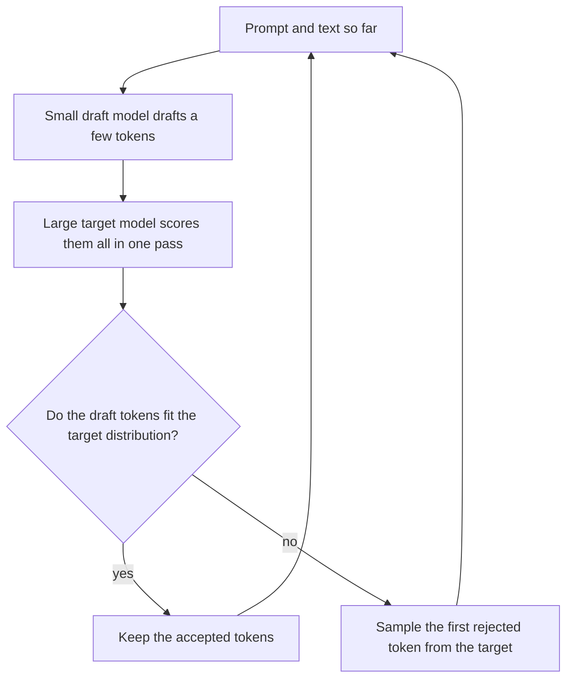

# 08. Inference

**Level:** Practitioner · **Reading time:** 15 min · **Exercise:** 45 min
**Prerequisites:** [Resource Accounting](02-resource-accounting-flops-memory-and-arithmetic-intensity.md), for arithmetic intensity, and [Transformer Architectures and Hyperparameters](03-transformer-architectures-and-hyperparameters.md), for attention.

> **In one sentence:** After this chapter you can explain why generating text is limited by memory rather than arithmetic, estimate how fast one model can generate on one GPU, and choose among the standard ways to make serving cheaper.

## Why this matters

Training is paid once. Inference, the work of generating text from a trained model, is paid every day. Percy Liang opens Lecture 10 with a scale for that: OpenAI was estimated to produce 8.6 trillion tokens a day, while DeepSeek v4 was trained on 32 trillion tokens. On his count, a provider emits more tokens in under four days than went into training a frontier model.

Agents make it worse. A chatbot's output stops when a human stops reading. An agent thinks, calls tools and introspects, and most of those tokens are never read by anyone. Liang's summary: "you should really think about the number of tokens generated as really the compute spent" ([2:00](https://www.youtube.com/watch?v=EfM546A79aM&t=120)).

So the questions are practical. How fast can one user's reply arrive? How many users can one GPU serve? And what are the levers?

## The core idea

The model produces a probability for every token in its vocabulary as the next token. Generation repeats that: pick a token, append it, ask again. How the token is picked is background that Lecture 10 does not cover, but the vocabulary is needed later in this part. **Greedy decoding** always takes the most likely token and is deterministic. **Sampling** draws from the distribution, and settings like **temperature** (flattening or sharpening it) and **top-p** (keeping only the most likely tokens that together reach probability p) control how random the draw is.

The loop has two stages with opposite bottlenecks:

- **Prefill**: process the whole prompt at once. Every token is known, so this runs in parallel, like training. It is compute-bound.
- **Generation** or decoding: produce one token at a time. Each step depends on the one before. It is memory-bound.

The reason for the second is arithmetic intensity (Chapter 02). In one decoding step, the model multiplies its weight matrices by a single vector. Every weight must be read from memory, and each is used exactly once. That is about one FLOP per byte moved, far below what a GPU needs to stay busy.

To avoid recomputing the past at every step, the server keeps a **KV cache**: the keys and values of every previous token in every layer, so a new token can attend to them directly.

## How it works, step by step

### 1. Count one decoding step

Bytes moved per step = model weights + KV cache. FLOPs = 2 × active parameters. Time is the larger of the two divided by the hardware's rate. For generation, memory wins:

`seconds per token ≈ (bytes of weights + bytes of KV cache) ÷ memory bandwidth`

### 2. Batch requests, up to a point

With B requests in a batch, the weights are read once and used B times. Intensity rises to about B. On an H100 an operation becomes compute-bound above roughly 300, so batching is the first lever. Two things stop it:

- The KV cache grows with B and with context length. More bytes to read means slower steps and, eventually, no memory left.
- Attention does not benefit. Each sequence has its own KV cache, so batching cannot share that traffic.

| Batch size | Latency for one request | Throughput over all requests |
|---|---|---|
| Small | Better | Worse: weights are re-read for few requests |
| Large | Worse: larger KV cache to read | Better, until memory fills |

**Latency** is seconds per token for one request. **Throughput** is tokens per second across all requests. **Time to first token** is mostly the prefill time of the prompt. Liang's reading of the three: time to first token and latency matter for interactive use, throughput for batch jobs, where it does not matter whether one query finishes sooner ([4:00](https://www.youtube.com/watch?v=EfM546A79aM&t=240), [6:00](https://www.youtube.com/watch?v=EfM546A79aM&t=360)). His formulas for the table: latency is linear in B, because the KV cache grows with it, and throughput is B divided by that, which rises and then flattens ([40:00](https://www.youtube.com/watch?v=EfM546A79aM&t=2400)).

### 3. Shrink the KV cache

| Technique | Idea | Lecture's figure or finding |
|---|---|---|
| Grouped-query attention (GQA) | Several query heads share one key-value head | Cache shrinks by the ratio of query to key-value heads. In his example a 1-to-5 ratio lets a batch of 256 fit where it ran out of memory, at some cost in latency ([48:00](https://www.youtube.com/watch?v=EfM546A79aM&t=2880), [50:00](https://www.youtube.com/watch?v=EfM546A79aM&t=3000)) |
| Multi-query attention (MQA) | All heads share one key-value head | "which no one uses because it's really bad" ([46:00](https://www.youtube.com/watch?v=EfM546A79aM&t=2760)) |
| Multi-head latent attention (MLA) | Cache one compressed vector per token, expand when needed | DeepSeek v2: 16,384 dimensions down to 512 ([52:00](https://www.youtube.com/watch?v=EfM546A79aM&t=3120)), plus 64 for position |
| Cross-layer attention | Adjacent layers share keys and values | Better accuracy for a given cache size ([54:00](https://www.youtube.com/watch?v=EfM546A79aM&t=3240), [56:00](https://www.youtube.com/watch?v=EfM546A79aM&t=3360)) |
| Sliding-window layers | Attend only to nearby tokens | Cache size independent of length; can be mixed with a global layer or spaced out ([58:00](https://www.youtube.com/watch?v=EfM546A79aM&t=3480)) |
| Linear attention and state-space layers | Keep a compressed summary of the past instead of every token's keys and values | Used in place of sliding-window layers. A small summary loses details, so shipped models keep some full attention ([58:00](https://www.youtube.com/watch?v=EfM546A79aM&t=3480), [60:00](https://www.youtube.com/watch?v=EfM546A79aM&t=3600)) |

### 4. Use smaller numbers

**Quantization** stores weights in fewer bits. bf16 at 2 bytes per value is the default for inference. fp8 and int8 take 1 byte, int4 half a byte. Two routes exist:

- **Quantization-aware training**: simulate quantization during training. Better accuracy, expensive.
- **Post-training quantization**: quantize a trained model using a small sample of data to set scales. Cheap. GPTQ quantizes layer by layer and keeps track of the error, carrying it into the weights not yet quantized. AWQ keeps the few weights that matter most in high precision, about 1% in its paper: those that interact with large activation channels ([66:00](https://www.youtube.com/watch?v=EfM546A79aM&t=3960)).

### 5. Use a smaller model

Pruning removes unimportant layers, heads or dimensions, then distillation trains the smaller model to imitate the original. Liang's description: rip pieces out of a large model and fix it up. Crude, he says, but it works; an NVIDIA paper assembles the smaller model and repairs it with distillation ([66:00](https://www.youtube.com/watch?v=EfM546A79aM&t=3960), [68:00](https://www.youtube.com/watch?v=EfM546A79aM&t=4080)).

### 6. Check instead of generate: speculative sampling

Generation is slow because it is memory-bound. Checking is fast, because prefill is compute-bound. **Speculative sampling** exploits the gap:

1. A small **draft model** generates a few tokens, say four.
2. The large **target model** scores all of them in one parallel pass.
3. Tokens are accepted where the draft's choice agrees with the target's distribution. At least one new token is always produced.

The output is an exact sample from the target model, as if the target had generated it alone. Liang's version is modified rejection sampling: accept a drafted token with probability `min(1, q/p)`, where p is the draft's probability and q the target's, and otherwise sample from the difference of the two distributions ([74:00](https://www.youtube.com/watch?v=EfM546A79aM&t=4440)). Unlike plain rejection sampling, a rejection still yields a token. The setup is balanced on purpose. The draft is small, so generating one token at a time is cheap for it. The target is large, but it checks the drafts in one parallel pass, which is its fast mode ([72:00](https://www.youtube.com/watch?v=EfM546A79aM&t=4320)). The number of draft tokens has a sweet spot around three or four: too few wastes the target's parallel pass, too many raises rejections ([74:00](https://www.youtube.com/watch?v=EfM546A79aM&t=4440)). Speedup depends on how often the draft is right, and the draft should be as close to the target as its size allows ([76:00](https://www.youtube.com/watch?v=EfM546A79aM&t=4560)).

**Figure 1.** Speculative sampling: the small model drafts a few tokens, the large model checks them all in one pass, and each round ends with at least one new token.



Drafting is slow per token but cheap, and checking is one parallel pass, so the loop finishes in fewer rounds than one-token-at-a-time generation.

### 7. Run a server, not a loop

Live traffic arrives at different times and lengths. Three systems ideas, borrowed from operating systems:

- **Continuous batching**: decode one token for every sequence in the batch each step, evict finished sequences and add new requests as they arrive, instead of waiting for a whole batch to finish ([78:00](https://www.youtube.com/watch?v=EfM546A79aM&t=4680)).
- **Selective batching**: run attention per sequence, and concatenate all sequences into one long sequence for the MLP layers, which hold most of the FLOPs ([78:00](https://www.youtube.com/watch?v=EfM546A79aM&t=4680)).
- **Paging** (PagedAttention in vLLM): split each sequence's KV cache into non-contiguous blocks, as an operating system pages memory. It removes two kinds of waste: reserving room for a request's maximum length, and gaps between requests too small to use. Requests with the same prefix share blocks, which are copied only when they diverge. A shared system prompt, or several samples of one prompt, is computed once ([80:00](https://www.youtube.com/watch?v=EfM546A79aM&t=4800), [82:00](https://www.youtube.com/watch?v=EfM546A79aM&t=4920)).

The engines he names: vLLM as the go-to, SGLang for agentic workloads, NVIDIA's TensorRT as fast but narrower, and llama.cpp for running on a CPU ([4:00](https://www.youtube.com/watch?v=EfM546A79aM&t=240)).

What the lectures say about spending compute at inference time is short. Lecture 10 raises one case only: when the same prompt needs several responses, the responses share the prompt's cache ([82:00](https://www.youtube.com/watch?v=EfM546A79aM&t=4920)). Lecture 1 lists test-time compute among the reasons inference matters ([Lecture 1, 42:00](https://www.youtube.com/watch?v=JuoVZkPBiKk&t=2520)), and Lecture 16 uses a best-of-k filter on sampled solutions to select training data ([Lecture 16, 42:00](https://www.youtube.com/watch?v=dIFAi87Ws4E&t=2520)). None of them covers decoding strategies, best-of-n selection or search, which are treated in [reasoning in LLMs](../01-foundations/06-reasoning-in-llms-from-chain-of-thought-to-search.md).

## Worked example

```python
def decode_limits(params, kv_bytes_per_token, context, bandwidth, bytes_per_param=2):
    """Upper bounds for one request: milliseconds per token, tokens per second."""
    moved = params * bytes_per_param + context * kv_bytes_per_token
    seconds = moved / bandwidth
    return seconds * 1000, 1 / seconds

# Llama 2 13B: 40 layers, keys and values 5120 wide, bf16.
kv = 2 * 5120 * 2 * 40                      # bytes of KV cache per token
decode_limits(13e9, kv, 0, 3.3e12)          # about 7.9 ms, 127 tokens per second
decode_limits(13e9, kv, 4096, 3.3e12)       # about 8.9 ms, 112 tokens per second
```

What to observe:

- The first call moves only the weights: 26 GB at 3.3 TB/s, the bandwidth quoted in Lecture 2. The ceiling is about 127 tokens per second for one request on one H100. Liang's live calculation for the same model on the same chip gives 8 ms and 124 tokens per second at batch size 1 ([40:00](https://www.youtube.com/watch?v=EfM546A79aM&t=2400)).
- At a 4,096-token context the KV cache adds about 3.4 GB, and the ceiling drops to 112 tokens per second.
- These are ceilings. Real servers fall short of them, and they say nothing about throughput with many requests.
- With 8 key-value heads instead of 40 (grouped-query attention), the cache term shrinks five times.

## What the practitioners say

Lecture 10 works the arithmetic in full. The matrix multiply of weights by B rows is compute-bound only when B exceeds about 295 on an H100 ([16:00](https://www.youtube.com/watch?v=EfM546A79aM&t=960)), and in generation B is 1. His summary of the stages in one line: prefill is compute-bound, generation is memory-bound ([34:00](https://www.youtube.com/watch?v=EfM546A79aM&t=2040)). The root difference from training is that training sees every token at once and can parallelize over the sequence, while inference has to generate one at a time ([6:00](https://www.youtube.com/watch?v=EfM546A79aM&t=360)).

At [28:00](https://www.youtube.com/watch?v=EfM546A79aM&t=1680) he explains why batch size is awkward in live serving: in generation, B is the number of concurrent requests, which for a chatbot is the number of users at that moment, unpredictable and changing. That is what continuous batching addresses.

On the KV cache ([46:00](https://www.youtube.com/watch?v=EfM546A79aM&t=2760)): it can grow larger than the parameters themselves at a big enough batch size, which is why the first fix is to shrink it, carefully, without losing accuracy. On MLA ([52:00](https://www.youtube.com/watch?v=EfM546A79aM&t=3120)) he adds that the idea conflicts with rotary position embeddings, which is why extra dimensions are reserved for position.

He offers one opinion about architecture. State-space models, linear attention and diffusion models have, in his view, a great deal of room for improvement, because the KV cache and the way attention is built "fundamentally makes it an inference unfriendly kind of architecture" ([84:00](https://www.youtube.com/watch?v=EfM546A79aM&t=5040)). That is a forecast, not a result. For more, he points to the inference chapter of *How to Scale Your Model* ([44:00](https://www.youtube.com/watch?v=EfM546A79aM&t=2640)).

## Pitfalls

1. **Reporting speed at batch size 1 as capacity.** That measures latency. Fix: measure latency and throughput separately.
2. **Pushing batch size as high as memory allows.** Throughput gains shrink while latency worsens. Fix: find the knee for your traffic.
3. **Quantizing without an accuracy check.** Fix: evaluate the quantized model on your own tasks before shipping.
4. **Treating prefill and generation alike.** Long prompts make time to first token dominated by prefill. Fix: use smaller batches in prefill, larger in generation.
5. **Padding sequences to equal length.** Fix: use a server with continuous batching and paging.
6. **Assuming speculative sampling changes the output.** It does not, when implemented correctly. Fix: verify agreement on a fixed prompt set.
7. **Counting only parameters.** The KV cache dominates at long context. Fix: include it, as in the worked example.

## Try it

Save the `decode_limits` function and the `kv` line from the worked example. For another model, the cache per token is 2 × key-value width × bytes per value × layers, and the key-value width is the number of key-value heads times the head dimension, both on the model card.

**Deliverable:** a short table for three open-weight models of your choice: parameter count, layers, key-value heads, context length, and the resulting latency ceiling and KV cache size.

You are done when:

- Your script reproduces 127 and 112 tokens per second for the Llama 2 13B cases.
- For one model you show how the ceiling changes between full attention and grouped-query attention at a 128K context.
- One sentence explains why halving the parameter count roughly doubles the ceiling.

**Stretch:** run a small open-weight model locally, measure tokens per second for one request, and compare with your ceiling.

## Key takeaways

- Inference is a repeated cost; training is a one-time cost.
- Prefill is compute-bound. Generation is memory-bound, because each step reads every weight to produce one token.
- Speed for one request is bounded by memory bandwidth divided by bytes of weights and KV cache.
- Batching improves throughput and hurts latency. The KV cache limits how far it goes.
- The levers: a smaller KV cache, smaller numbers, a smaller model, speculative sampling, and a server that batches continuously and pages memory.

## Self-check

1. Why is generation memory-bound?
   - A. The vocabulary is too large to fit in cache
   - B. Each step reads every weight to produce one token
   - C. The softmax runs in low precision
   - D. Prompts must be processed one token at a time
2. What does the KV cache store?
   - A. The weights of the attention layers
   - B. The optimizer state from training
   - C. Keys and values of previous tokens in every layer
   - D. The sampled tokens and their probabilities
3. What happens when the batch size grows during generation?
   - A. Latency improves and throughput drops
   - B. Both latency and throughput improve without limit
   - C. Nothing changes for attention
   - D. Throughput improves and latency worsens
4. What is guaranteed by speculative sampling?
   - A. The draft model becomes as good as the target
   - B. Output distributed exactly as the target model alone would produce
   - C. A fixed speedup regardless of the draft
   - D. Deterministic output for every prompt
5. Why does paging help a serving engine?
   - A. It removes the KV cache from memory
   - B. It lets cache blocks be shared and placed without waste
   - C. It quantizes the weights on the fly
   - D. It makes prefill sequential

<details><summary>Show answers</summary>

1. B. One vector per step means about one FLOP per byte of weights.
2. C. It saves recomputing the past at each step.
3. D. Weights are read once for more requests, but each request's cache still has to be read.
4. B. The target model's scores decide acceptance, so the result matches its distribution.
5. B. Blocks can sit anywhere in memory and can be shared by requests with a common prefix.

</details>

## Sources

- **Lecture:** Percy Liang, "Lecture 10: Inference", Stanford CS336 Language Modeling from Scratch (Spring 2026): [video](https://www.youtube.com/watch?v=EfM546A79aM), used at [tokens as compute](https://www.youtube.com/watch?v=EfM546A79aM&t=120), [batching](https://www.youtube.com/watch?v=EfM546A79aM&t=1680), [KV cache](https://www.youtube.com/watch?v=EfM546A79aM&t=2760), [MLA](https://www.youtube.com/watch?v=EfM546A79aM&t=3120), [outlook](https://www.youtube.com/watch?v=EfM546A79aM&t=5040)
- **Reading:** Jacob et al., "How to Scale Your Model": [book](https://jax-ml.github.io/scaling-book/)
- **Reading:** Woosuk Kwon et al., "Efficient Memory Management for Large Language Model Serving with PagedAttention" (2023): [arXiv](https://arxiv.org/abs/2309.06180)
- **Reading:** Yaniv Leviathan, Matan Kalman and Yossi Matias, "Fast Inference from Transformers via Speculative Decoding" (2022): [arXiv](https://arxiv.org/abs/2211.17192)
- **Reading:** Joshua Ainslie, James Lee-Thorp et al., "GQA: Training Generalized Multi-Query Transformer Models from Multi-Head Checkpoints" (2023): [arXiv](https://arxiv.org/abs/2305.13245)
- **Reading:** Ji Lin et al., "AWQ: Activation-aware Weight Quantization for LLM Compression and Acceleration" (2023): [arXiv](https://arxiv.org/abs/2306.00978)

## Next

→ [Evaluating Language Models](09-evaluating-language-models.md), because a faster model is only useful if you can tell what it still does well. For running a model in a product, see [deploying a model](../07-ml-in-production/07-deploying-a-model.md) and [efficient LLM inference and deployment](../09-efficient-deep-learning/08-efficient-llm-inference-and-deployment.md). Sharding a model across GPUs is in [Parallelism](06-parallelism.md).
