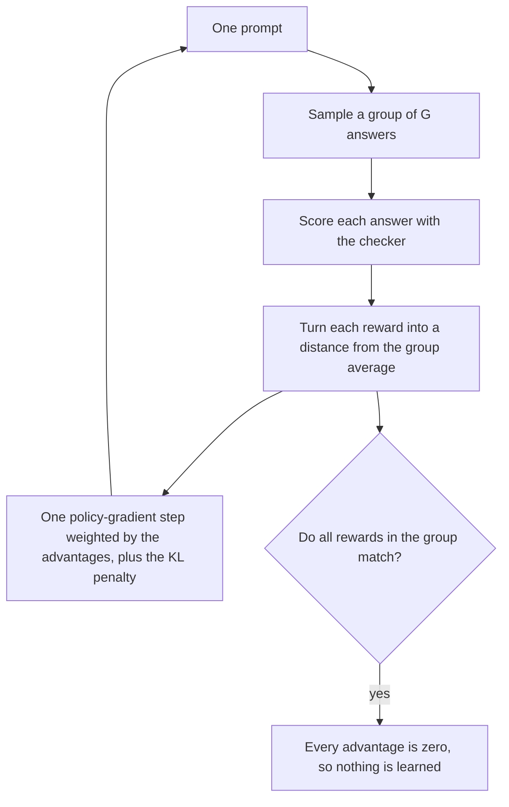

# 11. Post-Training: SFT, RLHF and RLVR

**Level:** Professional · **Reading time:** 17 min · **Exercise:** 60 min
**Prerequisites:** [from base model to assistant](../01-foundations/03-from-base-model-to-assistant-post-training.md), for the big picture, and [Training Data](10-training-data.md), for where post-training data comes from.

> **In one sentence:** After this chapter you can say what supervised fine-tuning and reinforcement learning from human feedback each add to a base model, write the GRPO update in a few lines, and explain why checkable rewards changed what reinforcement learning could do.

## Why this matters

A base model continues text. Given a question, it may answer, or add another question, or drift into something else. Steering it with examples in the prompt works only up to a point. The lecturer describes fine-grained control at the GPT-3 level as basically impossible ([0:00](https://www.youtube.com/watch?v=2oH6PWPrYFo&t=0)).

Turning that into an assistant is **post-training**. Lecture 15 covers the road from GPT-3 to a ChatGPT-style model. Lecture 16 covers the next step, to models that reason at length. One warning runs through both: public information is thin, because the best recipes are not published.

## The core idea

Pretraining gives the model a vast, general ability. The lecturer calls the result a primordial soup ([2:00](https://www.youtube.com/watch?v=2oH6PWPrYFo&t=120)) out of which post-training must extract specific behaviors. Two mechanisms do that:

- **Imitation**: show the model examples of the behavior and train it to reproduce them. That is **supervised fine-tuning** (SFT).
- **Reinforcement**: let the model produce answers, score them, and push its probabilities toward the better ones.

Imitation is simple and needs good examples. Reinforcement needs only a score, which is cheaper when judging is easier than writing. The analogy is learning a sport from videos versus from a coach who only says "better" or "worse". It breaks because the coach in reinforcement learning is often a second model that can be fooled, and the athlete will find the fooling out.

## How it works, step by step

### 1. Supervised fine-tuning

SFT data is pairs of a prompt and a wanted response, written in a fixed **chat template** with roles such as system, user and assistant. Training is the pretraining loss again, next-token prediction, applied only to the response tokens:

`minimize − Σ log π_θ(response token | prompt, earlier response tokens)`

`π_θ` is the model, and the sum runs over the tokens of the response.

Three facts about SFT data from Lecture 15:

- **Format matters as much as content.** SFT teaches two things at once, the format of a conversation and pieces of knowledge, and sets have moved toward structured chat formats ([Lecture 15, 16:00](https://www.youtube.com/watch?v=2oH6PWPrYFo&t=960), [22:00](https://www.youtube.com/watch?v=2oH6PWPrYFo&t=1320)). FLAN, an early collection, is a set of tasks in odd formats. Later sets look like real chat.
- **It takes less than you would expect.** A few thousand to tens of thousands of examples is typical. Llama 2 used a few thousand ([30:00](https://www.youtube.com/watch?v=2oH6PWPrYFo&t=1800)).
- **Quality is nuanced.** Bad responses teach bad behavior, so collect the best you can. What clearly hurts, the lecturer says, is training on facts the model does not already know: that teaches it to hallucinate ([24:00](https://www.youtube.com/watch?v=2oH6PWPrYFo&t=1440)).

Safety data is built the same way. The lecture's example is the open Tülu 3 recipe: logs of real chat use are mined for unsafe requests and jailbreaks, and annotators write the refusal that becomes the target response. The set is about 50,000 examples.

### 2. Reinforcement learning from human feedback

**RLHF** has three parts:

1. Collect **preference pairs**: for one prompt, two responses and a human's choice of the better one.
2. Train a **reward model** to predict the choice. It gives any response a score.
3. Train the model, now called the **policy**, to score highly with the reward model, while staying close to the original model. The leash is a **KL penalty**, a term that grows as the policy's token probabilities move away from the reference.

The algorithm behind step 3 evolved in three moves. A plain **policy gradient** multiplies the gradient of each action's log-probability by its reward:

`∇ E[R(z)] = E[R(z) · ∇ log p_θ(z)]`

Its variance is too high. The lecturer's progression in Lecture 15: reusing one rollout for several steps leads to importance weighting and a constraint that keeps the step close to the current policy (TRPO), and PPO replaces that constraint with a heuristic clip ([68:00](https://www.youtube.com/watch?v=2oH6PWPrYFo&t=4080)). In practice PPO also needs an experience buffer, a store of recent samples, and a value model, a second network that estimates the reward to come at each token ([Lecture 16, 8:00](https://www.youtube.com/watch?v=dIFAi87Ws4E&t=480)).

**Direct preference optimization** (DPO) removes the reward model and the reinforcement learning. It trains directly on the pairs, raising the chosen response's log-probability relative to the rejected one, measured against the reference model. The lecturer's verdict: "DPO is reasonably good. And it's good enough for Llama, it's good enough for me" ([74:00](https://www.youtube.com/watch?v=2oH6PWPrYFo&t=4440)). Llama's recipe alternated DPO with rejection sampling. He warns that comparisons between variants are fragile: papers from the same lab found DPO better than PPO and the reverse.

Two failure modes limit RLHF:

- **Over-optimization.** The policy learns to please the reward model rather than people. Without the KL leash, a long run drifts into nonsense that scores well.
- **Collapse of diversity.** The policy narrows to a few safe outputs, and its stated confidences stop matching reality.

### 3. Reinforcement learning from verifiable rewards

**RLVR** replaces the reward model with a checker: unit tests for code, an answer match for math. Nothing learned sits between the model and the score, so there is no reward model to fool. The lecturer's contrast is with AlphaGo, where the objective is exact, so "you can just put in as much compute as you want" ([2:00](https://www.youtube.com/watch?v=dIFAi87Ws4E&t=120)).

| | RLHF | RLVR |
|---|---|---|
| Score comes from | A model trained on human preferences | A program |
| Limit | Over-optimization of that model | Finding tasks that can be checked |
| Data needed | Preference pairs | Questions plus checkers |
| Typical algorithm | PPO or DPO | GRPO and its variants |
| Result | A helpful, safe assistant | Long reasoning on hard problems |

### 4. GRPO

**Group relative policy optimization** keeps most of PPO and removes the value function, which Lecture 16 calls the most complicated and annoying part of PPO. That value model is as large as the policy itself, so dropping it frees memory ([Lecture 16, 12:00](https://www.youtube.com/watch?v=dIFAi87Ws4E&t=720), [14:00](https://www.youtube.com/watch?v=dIFAi87Ws4E&t=840)). The baseline comes from other samples instead:

1. For one prompt, sample a group of G answers.
2. Score each with the checker.
3. Convert each reward to an **advantage**: its distance from the group average, in standard deviations.
4. Take a policy-gradient step weighted by these advantages, plus the KL penalty.

```python
def group_advantages(rewards):
    mean = sum(rewards) / len(rewards)
    std = (sum((r - mean) ** 2 for r in rewards) / len(rewards)) ** 0.5
    return [(r - mean) / (std + 1e-4) for r in rewards]   # 1e-4 avoids division by zero

print(group_advantages([1, 0, 1, 1]))   # [0.58, -1.73, 0.58, 0.58]
print(group_advantages([1, 1, 1, 1]))   # [0.0, 0.0, 0.0, 0.0]
```

The second call shows a property to remember. If every answer in the group scores the same, the prompt teaches nothing. Questions the model always solves or never solves are dead weight.

**Figure 1.** One GRPO round: a group of answers to one prompt is scored, and each reward becomes an advantage measured against the group.



The loop needs no value model: the group's own rewards say whether an answer was better or worse than average, and a group that scores all the same teaches nothing.

Two cautions from Lecture 16. Subtracting a baseline keeps a gradient estimate unbiased; dividing by the standard deviation, as GRPO does, breaks that baseline contract. A later analysis (Dr. GRPO) attributes R1-Zero's growth in answer length partly to this bias. And the division inflates the weight of questions that are too easy or too hard, where the rewards barely vary ([Lecture 16, 22:00](https://www.youtube.com/watch?v=dIFAi87Ws4E&t=1320), [24:00](https://www.youtube.com/watch?v=dIFAi87Ws4E&t=1440)).

### 5. What the released recipes do

- **DeepSeek R1** (as described in the lecture): start from the base model, apply RL with an accuracy reward and a format reward, and get R1-Zero. Then add a small amount of long reasoning examples as SFT, a reward for writing in one language, and a final SFT and RLHF stage for tasks that have no checker. R1-Zero lands only a little below OpenAI's o1 in the lecture's comparison. The lecture credits it with showing that process supervision, a grader for each step of a proof, was not critical ([Lecture 16, 28:00](https://www.youtube.com/watch?v=dIFAi87Ws4E&t=1680), [32:00](https://www.youtube.com/watch?v=dIFAi87Ws4E&t=1920)).
- **Kimi K1.5**: filter questions by difficulty, keep those the model fails on its best of eight tries, drop multiple-choice questions that reward guessing, and add a length penalty. The penalty is designed so that wrong answers do not collapse to zero length, or the model could never recover on that topic ([48:00](https://www.youtube.com/watch?v=dIFAi87Ws4E&t=2880)). The paper argues from a DPO-style starting point and arrives at a group-normalized baseline like GRPO's ([42:00](https://www.youtube.com/watch?v=dIFAi87Ws4E&t=2520)).
- Both drop questions the model has mastered, to spend compute where it is not wasted.

## Worked example

The smallest possible RLVR loop, with a checker in place of a real model:

```python
import math, random

def group_advantages(rewards):
    """Each reward as its distance from the group average, in standard deviations."""
    mean = sum(rewards) / len(rewards)
    std = (sum((r - mean) ** 2 for r in rewards) / len(rewards)) ** 0.5
    return [(r - mean) / (std + 1e-4) for r in rewards]   # 1e-4 avoids division by zero

def softmax(xs):
    es = [math.exp(x - max(xs)) for x in xs]
    return [e / sum(es) for e in es]

random.seed(0)
logits = [0.0] * 4          # a "policy": one score for each of four answers
correct = 2                 # the checker accepts only this answer

for step in range(60):
    probs = softmax(logits)
    group = [random.choices(range(4), probs)[0] for _ in range(16)]     # 16 samples
    rewards = [1.0 if a == correct else 0.0 for a in group]             # the checker
    for a, r in zip(group, group_advantages(rewards)):
        for i in range(4):
            logits[i] += 0.5 * r * ((1.0 if i == a else 0.0) - probs[i])  # gradient of log prob

print(round(softmax(logits)[correct], 3))    # 1.0 after 60 steps: the policy always answers 2
```

What to observe:

- No one ever told the policy which answer was right. It learned from the pattern of which of its own samples passed the checker.
- Train first, then change `correct` to another answer: the loop stalls, because the policy almost never samples it and every group scores all zeros.
- The loop is a **bandit**: each answer is scored once, with no steps inside it. Real reasoning has the same shape per response, with a long answer as one action.

## What the practitioners say

The lecturer's first claim is about order. Pretraining is the base, and skipping it for post-training gets you nothing you want ([2:00](https://www.youtube.com/watch?v=2oH6PWPrYFo&t=120)). His second is about taste: post-training is artisanal in many ways, he says, and real-world post-training is messier than any architecture work ([0:00](https://www.youtube.com/watch?v=2oH6PWPrYFo&t=0), [2:00](https://www.youtube.com/watch?v=2oH6PWPrYFo&t=120)). He points students at the pre-ChatGPT papers for their annotation guidelines and at Tülu 3 as the one open recipe worth reading.

On people, he notes a shift: labs now recruit expert and bespoke annotators, though low-paid non-expert annotation is still large. The two groups judge differently: non-experts emphasize formatting, experts factuality and inconsistency ([Lecture 15, 50:00](https://www.youtube.com/watch?v=2oH6PWPrYFo&t=3000), [56:00](https://www.youtube.com/watch?v=2oH6PWPrYFo&t=3360)). On data, the newer sets such as WizardLM and Tülu 3 have language models generate the instruction-following examples ([8:00](https://www.youtube.com/watch?v=2oH6PWPrYFo&t=480)).

On RLHF's ceiling, he recalls the early hope that thumbs-up and thumbs-down data could be collected indefinitely. The answer was no: the reward model gets overfit however well you regularize ([76:00](https://www.youtube.com/watch?v=2oH6PWPrYFo&t=4560)). That dead end is what makes RLVR matter. He also cites a GPT-4 plot showing that models lose calibration after RLHF, and says nobody has solved it ([78:00](https://www.youtube.com/watch?v=2oH6PWPrYFo&t=4680)).

On what counts as verifiable, he is careful. Kimi K1.5 used a model to judge answer equivalence in math, and proof checkers accept strings that should not pass: "the notion of verifiable rewards is actually much trickier than many of you might initially think" ([68:00](https://www.youtube.com/watch?v=dIFAi87Ws4E&t=4080)). He closes with three things to know: it is all about the reward, GRPO is the tool most open work is built on, and task-specific gains, such as one 3-billion-active-parameter model reaching 70.6% on SWE-bench in the lecture's example, do not guarantee general improvement.

## Pitfalls

1. **SFT on mismatched formats.** Fix: use one chat template for training and serving, and mask the loss on prompt tokens.
2. **Starting RL from a base model with no SFT.** Fix: SFT first, so samples are on-format and scoreable.
3. **Dropping the KL leash in RLHF.** Fix: keep it, and track a human- or held-out-preference score against the proxy.
4. **Trusting a checker.** Models find its holes. Fix: test the checker with adversarial answers before training against it.
5. **Training on questions that are too easy or too hard.** Their groups have zero advantage. Fix: filter by success rate and update the set as the model improves.
6. **Penalizing length bluntly.** Fix: penalize only relative excess, as in the lecture's example.
7. **Reading too much into algorithm comparisons.** Fix: compare on your own data and setup.

## Try it

Run the worked example.

**Deliverable:** a short report on four experiments with the toy loop.

You are done when:

- The default run ends with a probability above 0.95 on the correct answer.
- You print the share of groups with all-equal rewards over time, and explain in two sentences why it rises.
- You rerun with 4 samples per group and with 64, and report how many steps each needs to pass 0.95.
- You make the checker wrong on one answer and show the policy learning the wrong behavior.

**Stretch:** add a second correct answer and a small penalty on answer length, then describe what the policy converges to.

## Key takeaways

- SFT teaches format and behavior with a few thousand good examples, using the pretraining loss on response tokens.
- RLHF trains against a learned reward model. It improves helpfulness and safety, and it over-optimizes and narrows output. DPO is a simpler alternative that works well enough for Llama.
- RLVR replaces the reward model with a checker, so compute can be spent without a ceiling from a learned proxy.
- GRPO drops the value network and uses the group's own rewards as the baseline. It is short to write and easy to break with bad questions.
- The reward is the whole design. Checkers have holes, and length and difficulty biases creep in.

## Self-check

1. What is trained in SFT?
   - A. The loss on response tokens only, given the prompt
   - B. A reward model on preference pairs
   - C. A value network for PPO
   - D. The tokenizer on chat templates
2. What limits RLHF from improving without end?
   - A. The size of the KL penalty
   - B. Over-optimization of a learned reward model
   - C. The lack of prompts
   - D. The speed of inference
3. What does GRPO use instead of a value network?
   - A. The average reward of the whole run
   - B. A second policy as a critic
   - C. The rewards of the other samples in its group
   - D. The reward model's uncertainty
4. What happens with a GRPO group in which every sample scores 1?
   - A. All advantages are positive
   - B. All advantages are zero
   - C. The gradients explode
   - D. The KL penalty doubles
5. Why is the Kimi K1.5 length penalty not applied fully to wrong answers?
   - A. Wrong answers are already short
   - B. The checker ignores length
   - C. So the model can still recover on topics it is bad at
   - D. To keep the KL penalty small

<details><summary>Show answers</summary>

1. A. It is next-token prediction on the assistant's part of the conversation.
2. B. The policy drifts toward what the reward model rates highly, not what people want.
3. C. Each reward becomes a z-score within its group.
4. B. With no spread, the std term is zero and the step is zero.
5. C. Collapsed answers would never earn a positive reward again on that topic.

</details>

## Sources

- **Lecture:** Stanford CS336, "Lecture 15: Mid/Post-Training", Language Modeling from Scratch (Spring 2026): [video](https://www.youtube.com/watch?v=2oH6PWPrYFo) · [guide](../lectures/cs336-15-midpost-training-sftrlhf.md), used at [control](https://www.youtube.com/watch?v=2oH6PWPrYFo&t=0), [pretraining first](https://www.youtube.com/watch?v=2oH6PWPrYFo&t=120), [SFT scale](https://www.youtube.com/watch?v=2oH6PWPrYFo&t=1800), [PPO](https://www.youtube.com/watch?v=2oH6PWPrYFo&t=4080), [DPO](https://www.youtube.com/watch?v=2oH6PWPrYFo&t=4440), [calibration](https://www.youtube.com/watch?v=2oH6PWPrYFo&t=4680)
- **Lecture:** Stanford CS336, "Lecture 16: Post-Training: Reinforcement Learning from Verifiable Rewards", Language Modeling from Scratch (Spring 2026): [video](https://www.youtube.com/watch?v=dIFAi87Ws4E), used at [motivation](https://www.youtube.com/watch?v=dIFAi87Ws4E&t=120), [length penalty](https://www.youtube.com/watch?v=dIFAi87Ws4E&t=2880), [verifiability](https://www.youtube.com/watch?v=dIFAi87Ws4E&t=4080)
- **Reading:** Long Ouyang et al., "Training Language Models to Follow Instructions with Human Feedback" (2022): [arXiv](https://arxiv.org/abs/2203.02155)
- **Reading:** Rafael Rafailov et al., "Direct Preference Optimization: Your Language Model is Secretly a Reward Model" (2023): [arXiv](https://arxiv.org/abs/2305.18290)
- **Reading:** Zhihong Shao et al., "DeepSeekMath: Pushing the Limits of Mathematical Reasoning in Open Language Models" (2024), the paper that introduced GRPO: [arXiv](https://arxiv.org/abs/2402.03300)
- **Reading:** DeepSeek-AI, "DeepSeek-R1: Incentivizing Reasoning Capability in LLMs via Reinforcement Learning" (2025): [arXiv](https://arxiv.org/abs/2501.12948)
- **Reading:** Zichen Liu et al., "Understanding R1-Zero-Like Training: A Critical Perspective" (2025): [arXiv](https://arxiv.org/abs/2503.20783)

## Next

→ [Alignment and Multimodality](12-alignment-and-multimodality.md), which steps back to what CS336 means by alignment and then adds images to the token stream. For search and reasoning strategies at inference time, see [reasoning in LLMs](../01-foundations/06-reasoning-in-llms-from-chain-of-thought-to-search.md). The course's RL assignment is described in [Building Your Own](13-building-your-own-a-roadmap-through-the-assignments.md).
