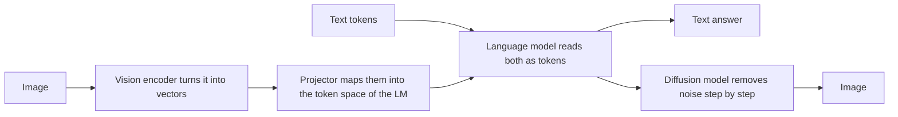

# 12. Alignment and Multimodality

**Level:** Professional · **Reading time:** 14 min · **Exercise:** 45 min
**Prerequisites:** [Post-Training: SFT, RLHF and RLVR](11-post-training-sft-rlhf-and-rlvr.md), for SFT, RLHF and GRPO, and [The Language Modeling Pipeline and Tokenization](01-the-language-modeling-pipeline-and-tokenization.md), for what a token is, and [Transformer Architectures and Hyperparameters](03-transformer-architectures-and-hyperparameters.md), for RoPE.

> **In one sentence:** After this chapter you can state what CS336 means by alignment, and explain how an image becomes tokens that a language model can read, and why generating images calls for a different tool.

## Why this matters

The course builds a model that maps text to text. Every frontier model also reads images, audio and video, and some produce them. A Transformer accepts tokens and returns tokens, so the question is literal: what token represents a patch of an image?

Before that question, the course places one more. A pretraining run teaches a model to predict text, not to be useful or safe. CS336 calls the work that closes that gap **alignment**, and it is the fifth and last unit.

## Part one: what CS336 means by alignment

Percy Liang frames the unit in Lecture 1 as a change in supervision. Pretraining is full supervision: every token has one right answer, the next one. Alignment moves to weak supervision, because "it's easier to critique than it is to generate" ([60:00](https://www.youtube.com/watch?v=JuoVZkPBiKk&t=3600)). You may not be able to write the ideal response to a prompt, but you can say which of two responses is better.

The template he gives has three steps:

1. Generate responses from the model.
2. Score them with a human, a verifier or a model acting as judge.
3. Update the model to prefer better responses.

Chapter 11 fills in the three steps. SFT covers the case where the good response is written for the model. RLHF scores with humans through a reward model. RLVR scores with a program. The course's fifth assignment is RLVR with GRPO on math problems, with instruction tuning and safety fine-tuning as an optional supplement.

Liang's own preference, stated in Lecture 1, is to stay with full supervision as long as possible and turn to reinforcement learning last, because RL algorithms are unstable and hard to tune, and RL at scale brings systems challenges of its own ([60:00](https://www.youtube.com/watch?v=JuoVZkPBiKk&t=3600)).

Lecture 15 puts content into "good". InstructGPT asked its raters to judge outputs on three axes, helpful, truthful and harmless, and raters had to balance all three ([Lecture 15, 46:00](https://www.youtube.com/watch?v=2oH6PWPrYFo&t=2760)). It also puts safety on post-training. Pretraining can stay in an ivory tower of compressing the world, while the post-training team is the last line of defense against misuse, and refusing malicious inputs is the de facto control ([Lecture 15, 28:00](https://www.youtube.com/watch?v=2oH6PWPrYFo&t=1680)). That control is cheap to install. With a capable model, the lecturer says, as few as 500 examples of unsafe requests paired with refusals cut the rate of following malicious instructions dramatically, because the model already has a safe and an unsafe side after pretraining. Fine-grained distinctions still need large data collection ([Lecture 15, 32:00](https://www.youtube.com/watch?v=2oH6PWPrYFo&t=1920)).

## Part two: the core idea of multimodality

A **token** in this course is a semantic unit: a piece of a word. A pixel is not. The lecturer's phrase at [2:00](https://www.youtube.com/watch?v=26FtD08ZpOU&t=120) is that Transformers speak tokens, discrete or continuous, and that each token should carry some semantic unit of information. So every other modality has to be turned into tokens first, the way Chapter 01 turned bytes into word pieces.

Two questions follow:

- **Understanding**: how do images, audio and video go in?
- **Generation**: how do images and audio come out?

Lecture 17 spends almost all its time on the first. The long-term target is an **omni model**, one that takes any combination of modalities and produces any combination.

## How it works, step by step

### 1. CLIP: learning what images mean from their captions

**CLIP** (contrastive language-image pretraining) was OpenAI's answer to a question: language models learn from noisy web text, so can vision learn from the web's noisy image-caption pairs?

1. Take a batch of image and caption pairs.
2. Encode every image with a vision network and every caption with a text network.
3. Score each image against every caption in the batch.
4. Train so that each image prefers its own caption, and each caption its own image.

Trained on 400 million pairs ([8:00](https://www.youtube.com/watch?v=26FtD08ZpOU&t=480)), CLIP classifies ImageNet better without labels than a ResNet, the standard image classifier of that time, trained on ImageNet's 1.2 million labeled images ([16:00](https://www.youtube.com/watch?v=26FtD08ZpOU&t=960)). Two limits matter later. The training objective is about choosing between captions, so the image embedding captures meaning, not fine detail. And the softmax runs across the whole batch, which pushes batch sizes very high.

### 2. SigLIP: the same idea with a cheaper loss

**SigLIP** replaces the comparison across the batch with a yes-or-no question for every image-caption pair: do they match? Batch size no longer sets the difficulty. In the figures quoted in the lecture, CLIP took 10 days on 256 TPUv3 chips and SigLIP 5 days on 32 TPUv4 ([24:00](https://www.youtube.com/watch?v=26FtD08ZpOU&t=1440)).

### 3. The standard recipe: encoder, projector, language model

| Part | Job | LLaVA's choice |
|---|---|---|
| Vision encoder | Turns an image into a set of vectors | CLIP |
| Projector | Maps those vectors into the language model's embedding space | One linear layer |
| Language model | Reads the vectors as if they were tokens | Vicuna, a fine-tuned Llama |

**LLaVA** built its training data by prompting GPT-4 with image captions to write 158,000 conversations ([30:00](https://www.youtube.com/watch?v=26FtD08ZpOU&t=1800)), then paired them with the images. Training has two stages: first only the projector, with both large parts frozen ([32:00](https://www.youtube.com/watch?v=26FtD08ZpOU&t=1920)), then the projector and the language model together.

**Figure 1.** A vision-language model: the image arrives through an encoder and a projector, is read as tokens next to the text, and can leave as text or, through a separate diffusion model, as an image.



The projector is the only bridge between the two modalities: everything to its right is an ordinary language model working on tokens.

### 4. Resolution

CLIP resizes and crops every image to 336 by 336 pixels. A document shrunk that far cannot be read. The lecturer's example is OCR, reading text from images: "otherwise a J looks like an I" ([36:00](https://www.youtube.com/watch?v=26FtD08ZpOU&t=2160)).

**AnyRes** is the fix. Split a large image into tiles, each at the encoder's resolution, encode each, and concatenate. If that yields too many tokens, downsample. LLaVA OneVision goes further and balances input types on purpose: a single image gets high resolution, each image of a set gets the base resolution, and each video frame gets less. Skills also transfer between input types: in the lecturer's example, OCR learned on single images helped the same model describe a series of screenshots, which is what a GUI agent needs ([44:00](https://www.youtube.com/watch?v=26FtD08ZpOU&t=2640)).

### 5. The Qwen vision-language line

Three ideas from the Qwen-VL models, as summarized in the lecture:

- **Dynamic resolution**: every 224 by 224 block of the image costs a fixed 66 tokens, whatever the image size.
- **Multimodal RoPE**: position is tracked along three axes, time, width and height, instead of one. Qwen3-VL interleaves the three so every axis sees both low and high frequencies, and adds explicit timestamp tokens for video ([54:00](https://www.youtube.com/watch?v=26FtD08ZpOU&t=3240)).
- **A square-root-normalized loss**: long video examples would otherwise dominate training. Normalizing each example's loss by the square root of its token count keeps text and video in balance.

### 6. Generation

Making an image is a different problem from reading one. Two routes exist:

- **Discrete tokens.** Train a **VQ-VAE**, a small network that compresses an image into a list of codes from a fixed codebook and reconstructs it. Chameleon turns a 512 by 512 image into 1,024 tokens from 8,192 codes, then trains one Transformer on text and image tokens alike. The model can then generate images with the same machinery it uses for text. The cost is information: discretization loses detail, which hurts exactly the fine-grained tasks such as OCR. Training is also unstable, because text tokens are predictable and image tokens are not. The fixes are QK-norm and a z-loss (Chapter 03), which is what Chameleon used to control the growth of the norms ([72:00](https://www.youtube.com/watch?v=26FtD08ZpOU&t=4320)).
- **Continuous vectors plus a diffusion model.** The language model plans, and a separate network trained to remove noise renders the image.

| Route | Understanding | Generation | Main weakness |
|---|---|---|---|
| Encoder + projector + LM | Strong | None by itself | Cannot produce images |
| Discrete tokens for everything | Weaker | Possible in one model | Loses detail; unstable training |
| Encoder for input, diffusion for output | Strong | Strong detail | Two systems to run and align |

## Worked example

What does an image cost a language model?

```python
def image_tokens(pixels=336, patch=14):
    """Tokens for one square image in a ViT with patches of `patch` pixels."""
    return (pixels // patch) ** 2

image_tokens()          # 576
5 * image_tokens()      # 2880: one overview tile plus four detail tiles
```

What to observe:

- One image through CLIP's ViT-L/14, a vision Transformer that cuts the image into 14-pixel patches, is 576 tokens, more than a long paragraph.
- Tiling a document into an overview and four details costs 2,880 tokens, roughly the size of 2,000 words of text.
- The same 672 by 672 image under Qwen2-VL's rule: nine blocks of 66 tokens, about 594. The budget depends on the design, not only on the image.
- A video at two frames per second multiplies the problem by its length. That is why frames are sampled sparsely and losses are normalized.

## What the practitioners say

The lecturer's starting claim is pragmatic. Transformers work better than the alternatives across modalities at scale, "so we have to figure out how to use them" ([0:00](https://www.youtube.com/watch?v=26FtD08ZpOU&t=0)). The lecture is an overview, given in place of a planned extra session on reinforcement learning, and the course sets no assignment on it. The lecturer's encouragement is to try training one of these models if curious ([76:00](https://www.youtube.com/watch?v=26FtD08ZpOU&t=4560)).

On the recipe, the slide summary is that most of the work is data curation, heavy on synthesized task-specific data. LLaVA OneVision's data was chosen for quality over quantity and trained from easier to harder. Skills transfer between input types: OCR learned on single images helped the same model act as a GUI agent.

On CLIP, the lecturer reminds the class to read its results with the fact that its design decisions were tuned for image classification, not for fine-grained tasks.

His closing position on generation: comprehension wants semantics, generation wants fine detail, and the two may demand different things. His description of the current best arrangement is continuous encoders for understanding, a Transformer in the middle, and diffusion models for generation, with video balanced against text because video carries less information per token.

Lecture 1 gives the context for why this is one lecture. Liang listed multimodality among the topics the course does not cover in depth ([22:00](https://www.youtube.com/watch?v=JuoVZkPBiKk&t=1320)).

## Pitfalls

1. **Shrinking every image to the encoder's size.** Fix: tile at high resolution when detail matters.
2. **Letting video swallow the loss.** Fix: normalize per example and balance sources.
3. **Assuming discrete tokens solve generation.** Fix: test on detail-heavy tasks before choosing that route.
4. **Training text and image tokens together without stability fixes.** Fix: QK-norm and z-loss, as Chameleon did.
5. **Judging an encoder by classification scores alone.** Fix: evaluate on tasks that need detail.
6. **Expecting the model to see what you see.** It sees the encoder's summary. Fix: check failure cases on small text and crowded scenes.

## Try it

Save the `image_tokens` function.

**Deliverable:** a token budget for three inputs: a photograph, a scanned page, and a one-minute screen recording.

You are done when:

- Each row shows the pixel size, the tiling you chose, and the resulting token count.
- The scanned page is legible at your chosen resolution, and you say how you checked.
- You state the video's count for 1, 2 and 5 frames per second, and pick one with a reason.
- Two sentences explain why a longer context window matters for video.

**Stretch:** run an open CLIP or SigLIP model on ten images of your own, label each with a few candidate captions, and record where it fails and whether the failure is about meaning or detail.

## Key takeaways

- For CS336, alignment means moving from full supervision to scored responses: generate, score with a human, verifier or judge, update.
- A Transformer speaks tokens. Other modalities must be converted into them.
- CLIP and SigLIP learn image meaning from captions. The standard vision-language model is an encoder, a projector and a language model.
- Resolution is the practical problem. Tiling keeps detail, at a token cost.
- Understanding wants semantics and generation wants detail, so current systems pair a continuous encoder with a diffusion model.

## Self-check

1. What does a vision encoder contribute in a vision-language model?
   - A. It generates the final image
   - B. It turns the image into vectors for the projector
   - C. It tokenizes the user's prompt
   - D. It stores the KV cache
2. How does SigLIP differ from CLIP?
   - A. It uses a larger vision network
   - B. It scores each image-caption pair on its own
   - C. It generates images from text
   - D. It removes the need for captions
3. Why does AnyRes split an image into tiles?
   - A. To keep fine detail that resizing would erase
   - B. To lower the token count of every image
   - C. To avoid training a projector
   - D. To make the encoder smaller
4. What is the main cost of representing images as discrete tokens?
   - A. The language model cannot read text any more
   - B. Detail is lost, which hurts tasks such as OCR
   - C. Training needs no normalization
   - D. Images cannot be compressed
5. What does the square root in Qwen3-VL's per-token loss prevent?
   - A. Long video examples dominating training
   - B. Short prompts being ignored by the tokenizer
   - C. Image tiles overlapping
   - D. The KL penalty from growing

<details><summary>Show answers</summary>

1. B. The projector then maps those vectors into the language model's embedding space.
2. B. The per-pair loss decouples batch size from the objective.
3. A. Each tile is encoded at full resolution and the results are concatenated.
4. B. Chameleon pays for one model for everything with weaker fine-grained performance.
5. A. It balances text and multimodal examples of very different lengths.

</details>

## Sources

- **Lecture:** Stanford CS336, "Lecture 17: Alignment - Multimodality", Language Modeling from Scratch (Spring 2026): [video](https://www.youtube.com/watch?v=26FtD08ZpOU), used at [tokens](https://www.youtube.com/watch?v=26FtD08ZpOU&t=120), [OCR](https://www.youtube.com/watch?v=26FtD08ZpOU&t=2160), [closing](https://www.youtube.com/watch?v=26FtD08ZpOU&t=4560)
- **Lecture:** Stanford CS336, "Lecture 15: Mid/Post-Training" (what "good" means): [video](https://www.youtube.com/watch?v=2oH6PWPrYFo&t=2760)
- **Lecture:** Percy Liang, "Lecture 1: Overview, Tokenization" (alignment unit): [video](https://www.youtube.com/watch?v=JuoVZkPBiKk&t=3600)
- **Reading:** Alec Radford et al., "Learning Transferable Visual Models From Natural Language Supervision" (2021): [arXiv](https://arxiv.org/abs/2103.00020)
- **Reading:** Xiaohua Zhai et al., "Sigmoid Loss for Language Image Pre-Training" (2023): [arXiv](https://arxiv.org/abs/2303.15343)
- **Reading:** Haotian Liu, Chunyuan Li, Qingyang Wu and Yong Jae Lee, "Visual Instruction Tuning" (2023): [arXiv](https://arxiv.org/abs/2304.08485)
- **Reading:** Chameleon Team, "Chameleon: Mixed-Modal Early-Fusion Foundation Models" (2024): [arXiv](https://arxiv.org/abs/2405.09818)

## Next

→ [Building Your Own: A Roadmap Through the Assignments](13-building-your-own-a-roadmap-through-the-assignments.md), which turns the twelve chapters before it into a plan of work.
