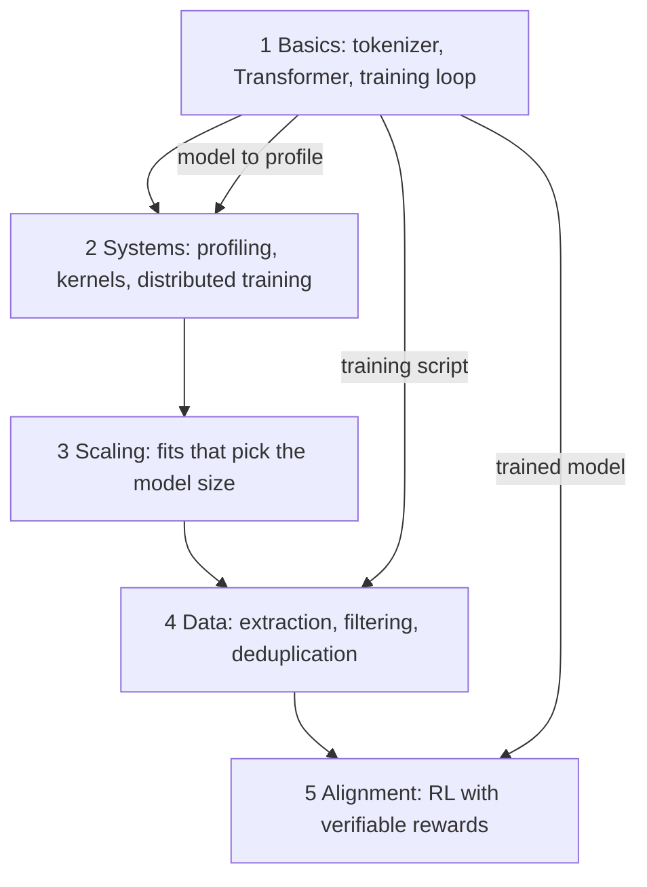

# 13. Building Your Own: A Roadmap Through the Assignments

**Level:** Practitioner · **Reading time:** 14 min · **Exercise:** 10 weeks

> **In one sentence:** After this chapter you have an order, a compute budget and a list of known traps for working through CS336's five assignments on your own.

## Why this matters

The course's method is understanding by building. Watching the lectures gives the map. The assignments are the territory.

The territory is steep. Lecture 1's outline quotes a Spring 2024 course evaluation: the first assignment alone was about the work of all five assignments plus the final project of the NLP course. Enrolled students get a cluster, a teaching staff and deadlines. You have none of those, so you need three things this chapter supplies: an order, a realistic idea of the compute, and the traps the handouts themselves warn about.

## The core idea

Five assignments follow the pipeline of this part, one per unit:

| # | Assignment | What you build | Chapters |
|---|---|---|---|
| 1 | Basics | Tokenizer, Transformer, loss, optimizer, training loop | 01 to 03 |
| 2 | Systems | Profiling, a FlashAttention kernel, distributed training | 02, 05, 06 |
| 3 | Scaling | Fits that predict loss and pick model size | 07 |
| 4 | Data | Text extraction, filtering, deduplication | 10 |
| 5 | Alignment | Reinforcement learning with verifiable rewards | 11 |

They share one shape. The handouts give no solution code. They give a test suite, and an `adapters.py` file of empty functions. You write the real code in your own module, then make each adapter call it. Until you do, every test fails with `NotImplementedError`. Each repository is public under the `stanford-cs336` organization on GitHub, and each README shows the setup with `uv`, a Python environment manager: clone, run `uv run pytest`, then fill the adapters.

The analogy is a test-driven project at work: the tests are written, the implementation is yours. The analogy breaks on size. Nothing here is a function to fill in. Assignment 1 is a small deep-learning framework.

Two course policies matter for self-study:

- **AI tools.** The handouts allow them for conceptual questions and for documentation such as library signatures. They forbid them for implementing any part of an assignment, including autocomplete. Percy Liang's reason, from Lecture 1: coding agents have become so good that they can solve all the assignments, and then plainly nobody learns anything ([24:00](https://www.youtube.com/watch?v=JuoVZkPBiKk&t=1440)).
- **Low-resource advice.** The handouts carry boxes with tips for working with few or no GPUs, and the course page advises "debugging correctness of your implementation on CPU first".

## The five assignments

Time and cost figures below are estimates for a self-learner, not course statements. Prices come from the course page.

### Assignment 1: Basics

- **You build:** a byte-pair encoding tokenizer, a Transformer with rotary positions and a gated MLP, cross-entropy, AdamW, a training loop that saves and restores state.
- **You learn** how the pieces of Chapters 01 to 03 fit into one program. The handout's rule is strict: almost nothing from PyTorch's neural-network and optimizer modules, only parameter containers and the optimizer base class.
- **What it takes:** tokenizer training and all correctness checks run on a CPU. Training a small model on TinyStories, a set of short children's stories, takes from minutes to a few hours on one GPU. The optional leaderboard asks for the lowest perplexity on OpenWebText in 45 minutes on a B200.
- **Handout warnings:** keep `adapters.py` as glue with no logic of its own, and do not edit the test files.

### Assignment 2: Systems

- **You build:** a benchmarking and profiling harness, activation checkpointing, a FlashAttention-style kernel in Triton, distributed data parallel training, sharded optimizer state and fully sharded data parallel training.
- **You learn** to find a bottleneck before fixing it, to read a profiler, and to write a kernel. The staff solution to Assignment 1 is supplied, so you can profile a model you did not write, or point the build at your own.
- **What it takes:** one GPU covers profiling and the kernel. The distributed parts want several. Expect the largest GPU bill of the five.
- **Handout warning:** profile first. Without it, you risk "optimizing parts of the model that don't account for significant time or memory". Memory profiling is required as well as time.

### Assignment 3: Scaling laws

- **You build:** a procedure that chooses model size, data and hyperparameters for a fixed compute budget, and predicts the loss.
- **You learn** to design a search and to fit and extrapolate, as in Chapter 07.
- **What it takes:** enrolled students do not train models. They call a training API with hyperparameters and a time limit and get back a validation loss. The target is a run of 48 B200 hours, and the budget for finding its settings is 12 more, a quarter of the target. The README tells non-students how to run the trainer and the API themselves, including a script that fetches tokenized data.
- **Handout warning:** the write-up must be detailed enough to reproduce the result, and part of the grade is the measured loss of the model you predicted.

### Assignment 4: Data

- **You build:** a pipeline from Common Crawl's raw HTML to text, filters for harmful content and personal information, and deduplication. Then you train models on variants to see what each decision does.
- **You learn** the pipeline of Chapter 10 on real data, and how much a processing choice moves the loss.
- **What it takes:** mostly CPU time and disk, then GPU time for the training comparisons. The training script is provided and supports multiple GPUs, and must be used unmodified for the leaderboard.
- **Handout warnings:** look at the raw data before writing code. The sample files are unfiltered web pages and may be distressing, and the handout says so.

### Assignment 5: Alignment

- **You build:** zero-shot, few-shot and chain-of-thought prompting, then GRPO, a reinforcement learning algorithm with a math grader as the reward. Variants compare different policy-gradient estimators.
- **You learn** the loop of Chapter 11 end to end: generate with a fast inference server, update weights, and repeat. The model is a 1B open model and the task set is grade-school math.
- **What it takes:** one GPU with tens of gigabytes. The repository ships the inference-server helper, a weight-sync utility and the grader. Instruction tuning, safety training and DPO are an optional supplement, although Lecture 1 lists them as core.
- **Handout warnings:** one dependency installs in two steps, and the RL tests are the required ones.

## Order and pace

Do them in order. Each one reuses the last: the model from 1 is profiled in 2, the training script in 4 descends from 1, and 5 needs a trained model to improve.

**Figure 1.** The five assignments in order, with the three things later assignments reuse from the first.



Assignment 1 feeds all the others, which is why doing it first matters more than the order of the rest.

For enrolled students, the course page's Spring 2026 deadlines gave about two and a half weeks to Assignment 1, two weeks to Assignment 2, one week to Assignment 3, two to Assignment 4 and two to Assignment 5, inside a ten-week quarter. For self-study, plan on roughly twice that, about twenty weeks at ten hours a week, and treat Assignment 1 as the half-way mark in effort.

Three shortcuts are reasonable:

- If you do only one, do Assignment 1. It delivers the model this whole part describes.
- If your goal is applications, read Chapters 07 to 12 and do Assignment 5.
- If you have no GPU budget, do the CPU parts of 1 and all of 4. Both carry real lessons without training runs.

## Compute for self-study

The course page has a section on self-study compute. It lists cloud providers with "public pricing for a single B200 GPU on March 28, 2026" and thanks Modal, the course's sponsor:

| Provider | Price per B200 hour | Note on the page |
|---|---|---|
| RunPod | $4.99 | |
| Nebius | $5.50 | $3.05 for preemptible instances |
| Modal | $6.25 | $30 of free compute per month; charged for actual use |
| Lambda Labs | $6.69 | |
| Together | $7.49 | Minimum of 8 GPUs |

The page was fetched on 2026-11-24. Prices change, so check before you budget.

## Worked example

A cost calculator with illustrative hours:

```python
PRICES = {"RunPod": 4.99, "Nebius": 5.50, "Modal": 6.25, "Lambda Labs": 6.69}  # per B200 hour

# Illustrative GPU hours for a self-learner who follows the low-resource tips.
assignments = {"A1 basics": 4, "A2 systems": 12, "A3 scaling": 8, "A4 data": 6, "A5 alignment": 10}

total = sum(assignments.values())
for provider, price in sorted(PRICES.items(), key=lambda item: item[1]):
    print(provider, round(total * price, 2))
# RunPod 199.6, Nebius 220.0, Modal 250.0, Lambda Labs 267.6
```

What to observe:

- Forty GPU hours cost between about $200 and $270 at the listed prices.
- The hours are guesses. Assignment 2 can triple them if you chase a fast kernel, and shrink them if one GPU is enough for you.
- Modal's monthly credit covers about five hours a month. Twenty weeks is about five months, so it pays $150 of the $250 bill.
- Nothing here includes the full student budgets of Assignment 3, 60 B200 hours on their own.

## What the practitioners say

Lecture 1 describes how the course works. There is no scaffolding code, but unit tests keep you from working blind for weeks on an unverified guess. Much of each assignment can be done on a laptop, and the cluster is for benchmarking speed and accuracy ([22:00](https://www.youtube.com/watch?v=JuoVZkPBiKk&t=1320)).

The last lecture is a guest talk by Dan Fu. Her one hoped-for takeaway: if you understand inference, the inference engines and the GPU kernels underneath them, you can innovate across the whole stack, algorithms included ([Lecture 18, 6:00](https://www.youtube.com/watch?v=9EEm4iMAF5s&t=360)). She contrasts synthetic benchmarks with real request traces, then follows a request through a serving system. Prefill resembles training, heavy in FLOPs. Decode is heavy in memory bandwidth, because every step loads all the weights, so engines now run the two on separate workers and tune each ([Lecture 18, 20:00](https://www.youtube.com/watch?v=9EEm4iMAF5s&t=1200)). When the KV cache outgrows GPU memory it spills to CPU memory and then to disk, one reason CPU and SSD speed matter ([Lecture 18, 26:00](https://www.youtube.com/watch?v=9EEm4iMAF5s&t=1560)). A rack of 72 fast-linked GPUs raises the questions of how to split a trillion-parameter model across it and what to do when one GPU fails ([Lecture 18, 30:00](https://www.youtube.com/watch?v=9EEm4iMAF5s&t=1800)). The outline also lists a set of production bugs and a lesson on reading profiler timelines, and ends with early scaling results for recurrent-style models. The useful takeaway for a self-learner is the gap it exposes: an assignment ends when the tests pass. A serving system begins there.

## Pitfalls

1. **Letting an agent write the code.** The handouts prohibit it, and the learning is the point. Fix: use AI to explain, never to implement.
2. **Putting logic in `adapters.py` or editing tests.** Fix: keep adapters as one-line calls into your own module.
3. **Reaching for the GPU to debug.** Fix: get shapes and round trips right on the CPU first.
4. **Optimizing before profiling** in Assignment 2. Fix: measure, then change one thing, then measure again.
5. **Spreading the scaling budget thin.** Fix: choose a few budgets and several sizes at each, and write down the prediction before you look.
6. **Not looking at the data** in Assignment 4. Fix: read rejected and kept samples before trusting a filter.
7. **Stale weights during RL.** In Assignment 5 the inference server and the trainer hold separate copies. Fix: confirm that the server uses the updated weights before each round.

## Try it

Start Assignment 1 and stop at the tokenizer.

**Deliverable:** a cloned repository with the tokenizer tests passing.

You are done when:

- `uv run pytest` runs, and every unimplemented test fails with `NotImplementedError`.
- The tokenizer tests pass, including a round trip on the TinyStories validation file.
- You have encoded a document with a special token in it and confirmed that it survives intact.
- You have written a five-line plan stating which parts you will do on a CPU and which need a GPU.

**Stretch:** train the small Transformer on TinyStories for an hour and read ten samples of its generated text.

## Key takeaways

- The five assignments follow the pipeline: basics, systems, scaling, data, alignment. Do them in order.
- No scaffolding is given, only tests and adapters. Your code lives in your own module.
- AI tools are for explanations and documentation, not for implementation.
- Debug on the CPU. The GPU is for training and benchmarking.
- A self-learner can finish on tens of GPU hours. Check current prices before you budget.

## Self-check

1. How do the assignments tell you your code is right?
   - A. By comparing against a hidden reference model
   - B. Through a provided test suite
   - C. By a leaderboard alone
   - D. By a grader reading the source
2. What may AI tools be used for under the handouts' policy?
   - A. Writing any part of the implementation
   - B. Completing code in the editor
   - C. Answering conceptual questions and documenting library interfaces
   - D. Generating the write-up
3. Which assignment do enrolled students complete without training models themselves?
   - A. Assignment 1
   - B. Assignment 2
   - C. Assignment 3
   - D. Assignment 4
4. Why does the course page advise debugging on the CPU?
   - A. GPUs do not support the tokenizer
   - B. Correctness checks need no GPU, and GPU time costs money
   - C. The tests cannot run on GPUs
   - D. CPU results are more accurate
5. What does Assignment 2 say to do before optimizing?
   - A. Profile to see where time and memory go
   - B. Rewrite everything in Triton
   - C. Double the batch size
   - D. Lower the precision

<details><summary>Show answers</summary>

1. B. Each test calls a function in `adapters.py`, which must call your implementation.
2. C. Implementation, including autocomplete, is off limits.
3. C. Assignment 3 queries a training API that returns the validation loss.
4. B. The page's advice is to get correctness right before paying for GPU runs.
5. A. Otherwise you optimize parts that do not matter.

</details>

## Sources

- **Course:** Stanford CS336, course page, fetched 2026-11-24: [cs336.stanford.edu](https://cs336.stanford.edu/)
- **Lecture:** Percy Liang, "Lecture 1: Overview, Tokenization", Stanford CS336 Language Modeling from Scratch (Spring 2026): [video](https://www.youtube.com/watch?v=JuoVZkPBiKk) · [guide](../lectures/cs336-01-overview-tokenization.md), used at [assignments](https://www.youtube.com/watch?v=JuoVZkPBiKk&t=1214), [learning by doing](https://www.youtube.com/watch?v=JuoVZkPBiKk&t=1320)
- **Lecture:** Dan Fu, "Guest Lecture", Stanford CS336 Language Modeling from Scratch (Spring 2026): [video](https://www.youtube.com/watch?v=9EEm4iMAF5s) · [guide](../lectures/cs336-18-guest-lecture-dan-fu.md), used at [takeaway](https://www.youtube.com/watch?v=9EEm4iMAF5s&t=360), [prefill and decode](https://www.youtube.com/watch?v=9EEm4iMAF5s&t=1200), [KV cache tiers](https://www.youtube.com/watch?v=9EEm4iMAF5s&t=1560)
- **Assignments:** Stanford CS336, Spring 2026 handouts and READMEs: [assignment1-basics](https://github.com/stanford-cs336/assignment1-basics), [assignment2-systems](https://github.com/stanford-cs336/assignment2-systems), [assignment3-scaling](https://github.com/stanford-cs336/assignment3-scaling), [assignment4-data](https://github.com/stanford-cs336/assignment4-data), [assignment5-alignment](https://github.com/stanford-cs336/assignment5-alignment)

## Next

→ Start with [The Language Modeling Pipeline and Tokenization](01-the-language-modeling-pipeline-and-tokenization.md) and keep this roadmap as your checklist. For the wider picture of where pretraining sits, see [how large language models are trained](../01-foundations/02-how-large-language-models-are-trained.md).
